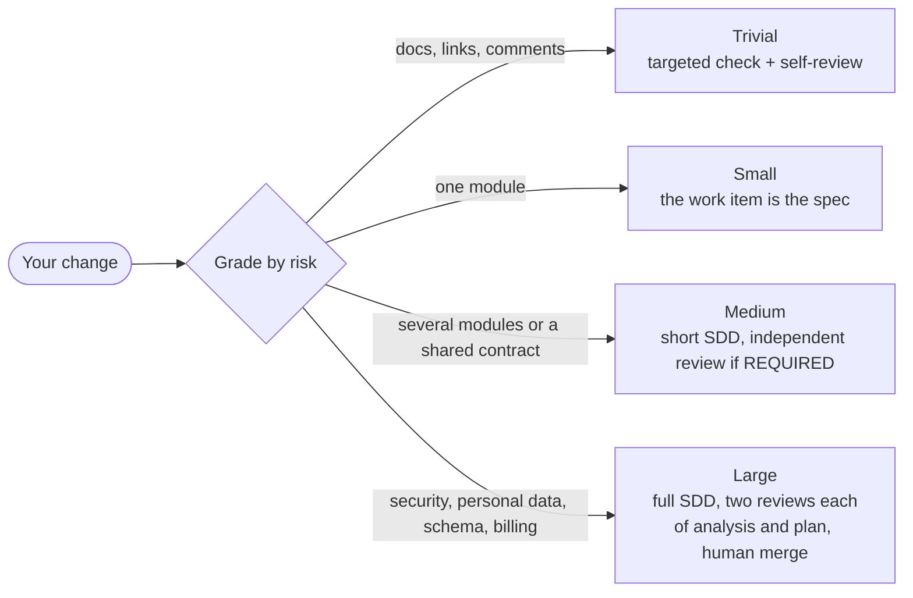

# Adaptive Agentic SDD

**Spec-driven development that knows a typo from a migration.**

Your AI coding agent (Claude Code or Codex) grades every change by risk first, then runs only the process that risk needs. A link fix gets a self-check. A database migration gets a written analysis and plan, two independent reviews of each, and a human merge.

[](https://github.com/seok-jun/adaptive-agentic-sdd/releases) [](LICENSE)

**English** | [한국어](ko/README.md)

> **Stable: [v1.1.0](https://github.com/seok-jun/adaptive-agentic-sdd/releases/tag/v1.1.0).** For existing codebases. Its effect on outcomes, rework or cost has not been measured yet; see [Status and evidence](#status-and-evidence).

**[Quick start](#quick-start) · [How depth scales](#how-depth-scales) · [What you get](#what-you-get) · [Evidence](#status-and-evidence)**



## Quick start

### Try it in a minute

```bash
git clone https://github.com/seok-jun/adaptive-agentic-sdd
python3 adaptive-agentic-sdd/try/setup.py
```

On Windows, use `python` (`python3` there often opens the Microsoft Store):

```powershell
git clone https://github.com/seok-jun/adaptive-agentic-sdd
python adaptive-agentic-sdd/try/setup.py
```

Setup takes about a minute. It creates `adaptive-sdd-try/` in your current folder: a tiny product, a team workflow, local Git remotes and a records folder. It writes nothing outside that folder and uses no network. Open `adaptive-sdd-try/START-HERE.md`, start Claude Code or Codex with the command shown there, and give it one of three planted tasks: a broken README link (Trivial), a pagination bug (Small) or password storage (Large). A task takes the agent a few minutes; allow it to run `git commit`, `merge` and `push` to the local remotes and to edit files in `records/` so it can finish. Add `--lang ko` for the Korean edition.



Shortened from two real Codex runs; see the [run record and its limits](docs/eval-results/2026-11-07-try-sandbox/README.md).

### Adopt in your project

**1. Paste this into Claude Code or Codex, opened in your project:**

```text
Read https://github.com/seok-jun/adaptive-agentic-sdd/blob/v1.1.0/docs/customization.md
and help me adopt Adaptive SDD for this project. Ask me before each write.
```

The agent walks you through the [adoption guide](docs/customization.md). It is agent-assisted setup, not an unattended installer. Requires Python 3.8+ and Git 2.36+.

**2. What you end up with.** Your product repository gains one three-line file. The workflow itself, a few dozen Markdown files of skills, procedures and project choices, lives in a separate repository your team owns and edits. Below, P is the product repository and W the workflow repository.

```text
your-product/                 your existing repository (P)
├─ src/ tests/ docs/          unchanged
├─ AGENTS.md                  unchanged; no blocks are added
└─ .agentics/default.yaml     NEW: link to your workflow commit
team-workflow/                NEW: Git repository your team owns (W)
├─ profile.json               where P's sources and work records are
├─ workflow/                  the four skills and procedures, editable
├─ methodology/               adopted core principles
├─ project/*.md               your choices: build, tracker, grading, routing ...
└─ LICENSE                    keeps the starter's MIT notice
user-config/agentics.json     NEW: your local allowlist, outside both repositories
work records                  GitHub Issues, or a location you choose
```

```yaml
# your-product/.agentics/default.yaml
methodology: example-team
version: team-1
commit: <full 40-character W commit SHA>
```

**3. Run your first task** in a fresh session:

```text
Fresh session. Select project workflow <name>, area default, task new-item.
Run the adoption guide resolver; stop unless READY, then read the resolved entry.
Create a work item for <a small change>, record the provisional-label/ID mapping,
then implement it and close it using this selected project W.
```

Sessions that do not select the workflow read none of it; team common instructions keep working as before. Details: [Setup in detail](#setup-in-detail).

## Why Adaptive SDD

Spec-driven development, made popular for coding agents by tools such as GitHub Spec Kit and Kiro, puts a written spec and plan in front of the code. Running that full process on every change buries small fixes in ceremony; skipping it lets risky changes through unreviewed. Adaptive SDD makes that call for each change, by written rule:

- **Process scales with risk, not file count.** The agent cannot lower an automatic escalation on its own.
- **The agent stops at human decisions.** Scope cuts, delegation, Large merges and new product decisions are asked, not assumed.
- **Your product repository stays clean.** No AGENTS/CLAUDE blocks or product-local skills. The project keeps only a small `.agentics/<area>.yaml` link, and the workflow is read only when someone selects it for a task.
- **Built for existing codebases.** The owning module's tests run first and checks widen only on evidence. Work is tracked in GitHub Issues and PRs or in a shared folder.
- **Evidence published as graded,** failures included.

## See it in action

Illustrative, shortened transcripts. Real output depends on your project settings.

```text
You:   Fix the broken link in docs/setup.md. Use Adaptive SDD.
Agent: Created T-12. Grade: Trivial — documentation only, no behavior change.
       Claimed T-12 (allowed: docs/setup.md).
       Fixed the link and checked that the target resolves.
       Self-review: the diff matches the requested scope.
       [IMPLEMENTATION SUMMARY] recorded. Branch ready for merge; claim released after merge.
```

```text
You:   Add a column for refund reasons to the payments table. Use Adaptive SDD.
Agent: Created T-31. Grade: Large — DB schema/migration (automatic escalation).
       Wrote the AS-IS analysis from the current code and schema.
       AS-IS Review A: PASS. Review B (blind): waiting for you to choose the reviewer model.
       ...
       PLAN reviews passed. Implemented within the allowed paths.
       Module tests first, then the required checks on the final candidate: PASS.
       Independent code review: PASS. Large changes need you to merge or explicitly order this merge — stopping here.
```

## How depth scales

Every execution work item gets one of four grades (an optional Epic that groups work items has none). The grading below describes the supplied starter when selected, not a requirement for every derived project W.

| Grade | When | Design documents | Review before code | Review of the change |
| --- | --- | --- | --- | --- |
| **Trivial** | No change to runtime behavior, contracts, tests, build or workflow meaning (typos, links, comments) | None | Self-check of the Trivial conditions | Targeted check + self-review |
| **Small** | Not Trivial, within one module, no escalation condition | None; the work item is the spec | Self-review of boundaries and verifiability | Self-review against the acceptance criteria |
| **Medium** | Two or more modules, or a shared contract the project designates | SDD: four short documents, or one page if the project chooses `condensed` | Bounded self-review; independent review when marked `REQUIRED` | Independent review if `REQUIRED`, otherwise self-review |
| **Large** | Security, personal data, DB schema/migration, background retry/schedule, billing or quota | SDD: four documents | AS-IS and PLAN each get Review A plus a blind Review B whose model a human chooses by default (a project can opt into one review, or let the agent choose the B model) | One independent code review; a human merges or explicitly orders that merge |

For each changed file that affects verification, the first check is the tests of the module that owns it, and checks widen only on evidence; a documentation-only Trivial change gets a targeted check that fits it. The required checks run on the final candidate, and a PASS is reused only when its inputs did not change. Definitions: [grades](adaptive-sdd/workflow/process/sdd/grade.md), [review gates](adaptive-sdd/workflow/process/verification.md#review-gate-by-grade).

## Setup in detail

Three names are used below: **P** is your product repository, **W** is the workflow repository your project owns, and **M** is the methodology published in this repository.

**Use M to start; own and evolve your W and P afterward.** Continued M use and updates are optional. The recommended external adoption path keeps an editable project workflow outside P and loads it only for a selected task. P keeps product facts, common rules and authority. Its only method connection is `.agentics/<area>.yaml`.

1. Follow the [adoption guide](docs/customization.md) to prepare an external project-owned W, reference P's real sources and choose record ownership. This is agent-assisted setup, not an unattended installer.
2. Review and commit W, map its name in your user-side allowlist, and place its commit in the area connection. This commit identifies **your W**, not an obligatory upstream M revision.
3. In a fresh session explicitly select a task/area. Run the guide's read-only `tools/agentics.py` command, read the resolved entry and check record access before editing. Without selection the resolver reads no method files; a selected failure stops dependent work.

The new path writes no AGENTS/CLAUDE blocks or product-local skills. A connection does not activate a method. See the guide's structure diagram, schemas, customization and [migration procedure](docs/customization.md#updates-and-migration). Existing `install.py` installations remain supported under the [legacy contract](docs/legacy-installation.md); they do not automatically migrate.

When using the supplied starter unchanged, it is ready to merge when the work item has a grade and acceptance criteria, a claim was taken before the first edit, the owning module's tests ran first and the required checks passed on the final candidate, an `[IMPLEMENTATION SUMMARY]` records decisions, verification and remaining risks, and the change request links back to the work item. Who merges follows your settings. It is done after the agent confirms the actual merge, closes the work item and records product completion (`[PRODUCT COMPLETE]`, or a field of the closing record for Trivial/Small). Adapt the selected W based on project needs and observed work; upstream M remains an optional reference.

## What you get

- **Four skills:** `managing-issues` (create and grade work items), `parallel-development` (claims and isolated worktrees), `implementing-issues` (design and implementation by grade), `finishing-issues` (verification, closing and cleanup).
- **A compact route for routine work:** Trivial and Small tasks follow [one procedure](adaptive-sdd/workflow/process/small-work.md) with a fixed reading set and three records (claim, summary, close) instead of preloading all four skills. Required checks, claims and merge authority stay the same as Medium.
- **Work tracking:** GitHub Issues and PRs, or work documents in a shared folder outside the repository. The procedures use tracker-neutral terms; each [adapter](adaptive-sdd/workflow/tracker/) maps them. Other trackers have no adapter yet.
- **Human-judgment boundaries:** the agent stops and asks instead of deciding scope reductions, delegations, Large merges or new product decisions ([core.md](adaptive-sdd/methodology/core.md)).
- **A read-only task resolver** (`tools/agentics.py`, Python standard library and Git) for explicit area selection, user-owned source mapping and W commit checks. The older installer is retained only for the separately chosen legacy model.
- **An evaluation kit:** behavior cases for each skill, a cross-agent runner and rules for turning a recorded incident into a test case ([skill-evals.md](adaptive-sdd/workflow/process/skill-evals.md)).

Repository layout: `adaptive-sdd/` is the canonical English distribution and adoption starter, `ko/` is the Korean edition with the same layout, `methodology/` is the core methodology alone, and `docs/` holds the installation guide and evaluation records.

## Status and evidence

- **Not measured:** no effect on outcomes, rework or cost has been measured. The procedures were refined in one product; that does not prove they work elsewhere.
- **1.1.0 Small before/after runs:** three Codex runs per version of one planted Small task all completed through merge and claim release. After the redesign, records fell from 7 to 3 and command output returned to the agent by a third; input tokens fell 8% and wall time showed no difference. One task, one agent — [record](docs/eval-results/2026-11-07-small-redesign/README.md).
- **1.0.1 routine-work trial:** five synthetic one-module Small tasks (Python, JavaScript, TypeScript, Java, Go) run with Codex completed implementation, required checks, local merge, closure and claim release, and independent clones confirmed behavior and scope. Three of five first attempts completed; the other two stopped on environment problems and completed after bounded fixes. This is not a speed or cost comparison — [record](docs/eval-results/2026-11-06-small-route/README.md).
- **Behavior evaluations:** a first cross-agent baseline ran 12 Korean cases × Claude Code and Codex × 3 runs (Claude Code 21 PASS / 14 FAIL / 1 INVALID, Codex 22 PASS / 14 FAIL) — [record](docs/eval-results/2026-10-30/README.md). A post-hoc paired check of two wording fixes found no overall improvement — [record](docs/eval-results/2026-10-30-skill-comparison/paired-summary.md). Failures are published as they were graded. In the baseline and in the preview.6 tracker check, the answer-key files were readable inside the evaluated projects, so those two runs are not clean evidence; the paired check removed them.
- **Not a guarantee:** this is guidance for agents and people, not a security boundary or an agent runner.

<details>
<summary>Earlier checks (preview.7, model routing, runner v2)</summary>

- **Historical preview.7 checks:** all 89 executable tests passed on Windows with Python 3.12.2, both 66-file bundle manifests matched, and an archive of the reviewed candidate (`0a65db9`) passed `init`, `render`, `check` and `check-evals` (83 cases) for both editions with both trackers. An independent read-only review (Codex `gpt-6-astra`, high) found no blocker and one P2, fixed in the README sandbox note; two optional P3 wording suggestions were not applied.
- **Historical preview.7 macOS portability:** preview.7 fixes generated POSIX checks to use `python3`. A rerun of the fixed commit `4986f1e` on the same Mac, without a `python` command, passed all 89 tests ([report](https://github.com/seok-jun/adaptive-agentic-sdd/pull/6#issuecomment-6541138071)). The earlier assisted walkthrough completed installation, a Small task and Undo; its initial failures and compatibility-alias diagnostic are in the [record](docs/eval-results/2026-10-31-macos-first-use/README.md). This is not blind first-use evidence. Live GitHub tracker operations have not been run.
- **Model routing (c′ policy relaxation):** the owner-approved change removes the positive capability-evidence requirement for the routine Trivial/Small current/manual lifecycle, subject to [routing eligibility](adaptive-sdd/workflow/skills/_shared/execution-routing.md#two-axis-routing). Other current/manual routes require fresh host evidence or a human-confirmed scoped assessment citing observed results; automatic switching, delegation and fallback still require PASS. A Codex first-use run with an empty capability table completed a Small task end to end ([record](docs/eval-results/2026-10-31-first-use/README.md)); this does not establish an effect on outcomes, rework or cost.
- **Runner v2:** subject bundles exclude answer keys; grader calibration on 11 synthetic answers agreed on 132/132 items across both graders ([record](docs/eval-results/2026-10-31-grader-calibration/README.md)). The c′ behavior check scored 5 PASS / 9 FAIL / 2 INVALID, with no `must_not` violation in the 14 graded runs. All Codex subjects failed to read files, and the positive-path fixture lacked an Issue ID, so the check is weak evidence; the runner was not fixed and no new frozen run was made for this release ([record](docs/eval-results/2026-10-31-routing-cprime/README.md)).

</details>

The full history of checks and reviews is in [CHANGELOG.md](CHANGELOG.md).

## Versions

- Minor 1.1.0 makes Small keep Medium's safeguards with Trivial's paperwork: a fixed reading set and three normal records. It also aligns the workflow docs with external adoption and includes first-use fixes. See [release record](docs/releases/1.1.0.md). Existing project workflows are not automatically updated.
- Patch 1.0.2 adds the one-command try sandbox, the README quick start and demo, issue forms, and keeps Claude Code session records in eval runners; the distribution is unchanged from 1.0.1. See [release record](docs/releases/1.0.2.md).
- Patch 1.0.1 adds a compact Trivial/Small route and explicit scratch/output boundaries. See [patch verification and limits](docs/releases/1.0.1.md). Existing project workflows are not automatically updated.
- Version 1.0 adopts the project-owned external W and explicit task activation model prepared in preview.8. See the [release notes and verification](docs/releases/1.0.0.md); historical evaluations do not validate the new activation path.
- The stable tag is `v1.1.0`; earlier previews use `v1.0.0-preview.N`. Published tags are never moved; fixes come as new version tags. Legacy installations pin a copy by tag, commit SHA and manifest hash; external adoption pins the selected project W commit.
- Project W evolves under project authority. M updates are optional; do not overwrite customized W. Legacy installations use their own [migration/upgrade guide](docs/legacy-installation.md#upgrading).
- The earlier v0.2 methodology is preserved at tag [`v0.2.0`](https://github.com/seok-jun/adaptive-agentic-sdd/tree/v0.2.0). v1 is not an automatic upgrade from v0.2.

## Contributing

Issues and pull requests are welcome; see [CONTRIBUTING.md](CONTRIBUTING.md). If Adaptive SDD is useful to you, a ⭐ helps other people find it.

## License

[MIT](LICENSE)
