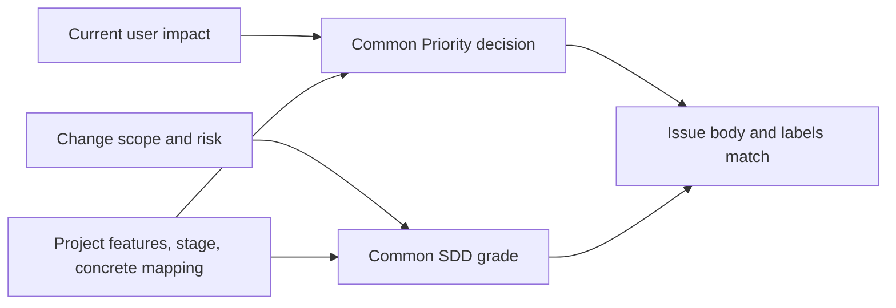

# Common issue priority and classification rules

This document is the source of the Priority decision, handling of insufficient evidence, and body/label rules applied in common to projects. Priority is the handling order by current user impact; SDD grade is the depth of procedure by change size and risk. Neither replaces the other. The project owns the core features, the current stage, the concrete application conditions and the verification commands.



## Priority decision order

A new Issue is checked in the order **P0 → P1 → P2 → P3**, and the first value that matches is used. Check the core features and the current usability goal in that project's documents.

| Priority | Common decision |
| --- | --- |
| P0 — Blocker | Basic entry fails; or a core flow fails completely with no normal workaround; or user data loss, corruption or wrong overwriting actually occurs or is reproducible; or secrets are exposed; or a migration failure makes continued use impossible |
| P1 — Usable | Not P0, but repeated failure of a core flow makes daily use difficult; or a feature currently essential for real use cannot be used; or requested core content is generated but cannot be opened, checked or used; or repeated manual recovery is needed; or the core feature itself must be given up with no reasonable workaround |
| P2 — Normal | Not P0/P1, and there is real inconvenience in current use, but a workaround or normal recovery is possible |
| P3 — Backlog | Not P0/P1/P2, and it does not affect the success/failure of current user features |

A preference that something is simply important or should be handled quickly is not grounds for P0. Do not put a change with confirmed risk, such as data loss or security exposure, into P3 in the name of development convenience. Priority is current impact and grade is change risk, so a high grade does not by itself mean a high Priority.

## When evidence is insufficient

- If there is no evidence to decide between P1 and P2, record **P2**.
- If it is not even confirmed that there is current user impact, record **P3**.
- When new evidence that raises the Priority appears, update `User impact` concretely and then change the Priority and the label together.

Do not use intermediate states such as `P1 candidate`, `probably P0` or `looks high` as Priority values.

## Order within the same Priority

Within the same Priority, choose in the following order.

1. An Issue that unblocks another P0/P1 Issue
2. A lower SDD grade
3. An Issue whose edit paths do not overlap with currently active lanes
4. If everything above is equal, the Issue created first (in the declared tracker method's creation order; for GitHub, the lower Issue number)

## Required body of a new Issue

A new implementation/bug Issue includes all of the following items.

Write the human-facing explanation starting from the key change, following the [visual writing criteria](agent-instruction-policy.md#visual-writing-of-human-facing-documents). Below is the minimum skeleton of the required items; for choosing comparison tables, relationships/flows and the Visual Spec, and for writing examples, follow the [detailed issue template](issue-writing-guide.md#issue-body-structure). Do not add required items or require pictures for simple changes.

```md
## Priority
P1

## SDD grade
Medium

## User impact
- One verifiable sentence on who experiences the problem in what situation

## Goal
- The key observable change after the fix. If a comparison is needed for the judgment, choose the before/after or responsibility expression from the detailed template

## Work scope
- Behaviors included

## Work boundaries
Allowed edits:
- Actually confirmed allowed paths
Forbidden edits:
- Actually confirmed forbidden paths

## Out of scope
- Behaviors not done in this Issue

## Acceptance criteria
- [ ] A condition whose pass/fail can be decided

## Dependencies / blockers
None
```

Do not use sentences such as `improve the current behavior`, `make the UX better` or `modify the necessary code`, from which the acceptance criteria or the edit targets cannot be identified, as the goal, scope or acceptance criteria.

## Required labels

Right after creation, a new Issue must have **exactly one each** of the following labels.

- Priority: `priority:P0`, `priority:P1`, `priority:P2`, `priority:P3`
- SDD grade: `grade:Trivial`, `grade:Small`, `grade:Medium`, `grade:Large`

If the declared tracker method can set both values when the Issue is created, set them in the creation. Otherwise set them right after creation, and do not report completion until a re-read confirms both values.

If the body value and the label differ, do not arbitrarily give the label priority. Re-check the decision evidence, then **correct the body and the label to the same value.**

### Body and labels of an Epic management document

The required body and grade rules for execution Issues above are not applied as is to an Epic management document. An Epic writes `Epic` under `## Work type`, is given the `type:epic` label and a Priority label, and has no `## SDD grade` or `grade:*`. The goal, overall acceptance criteria, common guidance, child Issue references with their responsibilities and dependencies, owners of open questions and the needed follow-up phases, and the overall completion evidence and its owner are kept in the existing body. Product edit paths and concrete verification are kept in the responsible execution Issue. Follow `W/process/sdd/epic.md`.

## Priority change

When changing the Priority, update all of the following in one cleanup.

1. `Priority` in the Issue body
2. `User impact`
3. Replace the `priority:*` value with the new value, as the declared tracker method writes it
4. Re-read the Issue and confirm that exactly one `priority:*` value remains

Changing the Priority alone does not change the SDD grade. Only when the implementation scope has changed, re-decide the grade with this methodology's common grades in `process/sdd/grade.md` and the project-specific application conditions.

A project's implementation queue and the Priority at which work may start follow that project's current stage conditions. Do not promote a Priority based only on precedence relationships or grade.
