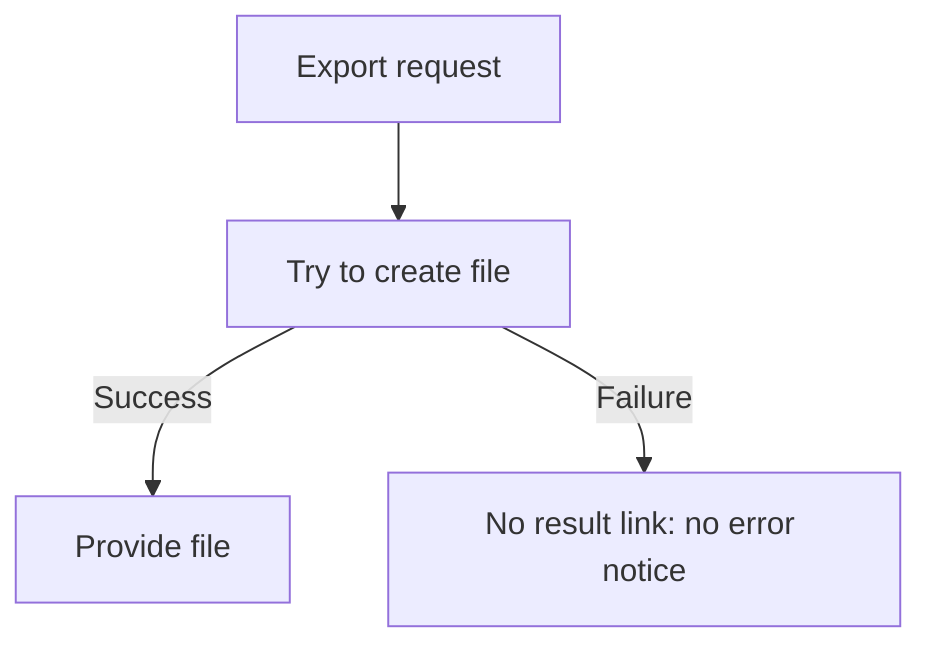
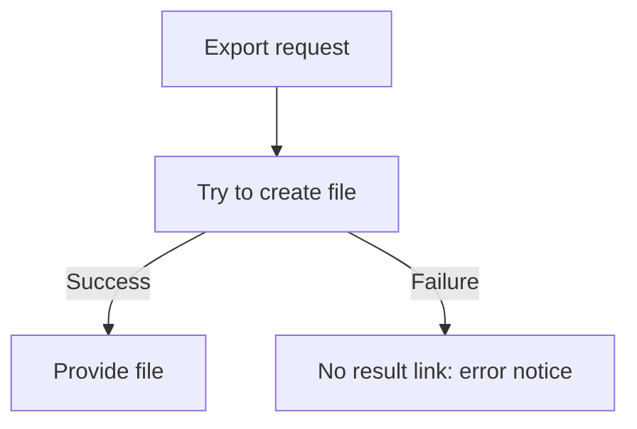

# issue-writing-guide procedure

The P application document `W/../project/issue-writing-guide.md` is the source of conditions, product facts, required verification and human authority. W owns the common classification criteria and how to carry them out.

Common Priority, SDD grade and body/labels follow the [common priority](issue-priority.md) and the [common grades](sdd/grade.md#sdd-grade). Read the P source together with them for product-specific application and authority.

## Role of each form of expression

Apply [Visual writing of human-facing documents](agent-instruction-policy.md#visual-writing-of-human-facing-documents) to the human-facing explanation of an Issue. Show the goal and key change first; policies and before/after differences may be explained with a small comparison table, and ownership, responsibility and system boundaries with a relationship diagram or boundary table. Even when the Mermaid creation conditions below do not apply, apply the comparison and relationship explanations that are needed. A simple change is sufficient in one sentence, and the number of pictures is not filled to a quota. The UI HTML creation conditions, product storage location and dependency restrictions remain as they are.

| Target | Expression | Source of Truth role |
| --- | --- | --- |
| Goal, policy, scope, acceptance criteria | Markdown Issue body | Feature behavior and work scope |
| Processing order, branches, state transitions | Mermaid | Visualization of the behavior flow in the Issue body |
| Static ownership, responsibility, system boundaries | Boundary table or optional Mermaid relationship diagram | Relationship explanation distinguished from execution order |
| UI layout, information hierarchy, screen states | HTML Visual Spec | UI/UX implementation baseline |

Use HTML only for UI/UX. Do not write provider routing, data flow, business processes or module architecture in HTML.

## Mermaid creation conditions

If even one of the conditions below is true, put Mermaid in the Issue body. In that case, do not replace the required flow diagram with sentences or comparison tables alone.

1. The order of existing processing steps changes.
2. One input branches into two or more execution paths depending on conditions.
3. An asynchronous flow such as WorkManager, retry, polling or a queue is added, removed or changed.
4. The implementation acceptance criteria require transitions between two or more states.
5. The call order of three or more components/modules changes.

If all the conditions above are false, a flow diagram is not mandatory. When static ownership, responsibility, system connections or boundaries are what is being judged, a boundary table or a Mermaid relationship diagram may be chosen. On the lines of a relationship diagram, write the meaning of the relationship, such as `owns the definition` or `responsible for publishing the result`, and do not imply a call order or state transition that does not actually exist. If a simple change is understood in one sentence, or a table shows the relationships sufficiently, no picture needs to be added.

Choose the format by the following rules.

- Sequential processing/conditional branches: `flowchart`
- Component call order: `sequenceDiagram`
- States and event transitions: `stateDiagram-v2`
- Static ownership, responsibility, system relationships: a boundary table, or a `flowchart` with the meaning of each connection marked. Add a note that these are static relationships.

Do not explain the same flow at length in both natural language and Mermaid. Show the order with Mermaid, but make the key relationships, conditions, failures and open items needed for the judgment readable without rendering, in short adjacent sentences or a table. Do not duplicate every node and arrow in prose. Of [static responsibility](visual-writing-examples.md#issue-ownership) and [required flow](visual-writing-examples.md#issue-flow), consult only the example needed for the current writing.

## HTML Visual Spec creation conditions

If the P application document `issue-writing-guide.md` does not declare a Visual Spec repository, this section and the HTML, design PR and Visual Spec link sections below do not apply. In that case, show UI changes with Mermaid, tables and short explanations, and if the request truly requires HTML, report `BLOCKED: visual spec storage undeclared`.

An HTML Visual Spec is created when the change is a **UI/UX change the user sees or operates** and even one of the conditions below is true.

1. A new screen is created.
2. A new major area is added to an existing screen, or an existing major area is removed.
3. A navigation, modal, bottom sheet, picker, gallery or tab structure is added, removed or changed.
4. The relative position or information hierarchy of two or more major UI areas changes.
5. The acceptance criteria require different representations of two or more screen states among default/loading/empty/error/disabled.
6. The user explicitly asks for a screen design, mock, wireframe or Visual Spec.

If all the conditions above are false, do not create HTML.

Do not create HTML when there are only the following changes.

- Text changes
- A single color/spacing/icon change
- Adding/removing one button whose existing position is exactly specified
- Logic changes not exposed in the UI
- Bug fixes that keep the existing layout

The agent does not add HTML just because "it would be nice to have a design". Decide only by the conditions above.

## HTML minimum content

A Visual Spec includes the following items.

1. The app Issue number and title
2. The name of the screen being changed
3. `Current` and `Proposed`, if the existing screen and the changed screen both need to be compared
4. The position and information hierarchy of the major areas
5. Every UI state included in the acceptance criteria
6. The main actions the user will perform and the screen state after each action

A Visual Spec is not a prototype that reimplements the app's features. Do not imitate network, DB or actual provider behavior with JavaScript.

## Design PR merge, deployment and cleanup

The design `main` is where verified drafts are shared and kept. State the draft/design status in the HTML or in the Visual Spec of the app Issue. **Merging a design PR is not approval of the app design, approval to start implementation, or completion of the product implementation.** The existing per-grade approvals and disclosure restrictions apply as they are, and this section adds no new human approval step.

Both the initial issue creation and any later Visual Spec revision perform the following within the same work.

1. Check the HTML's standalone structure, the main screens/states, that no external assets/APIs are used, and the existing rules on information that may be published. Pass the check commands of the design repository P declared and the PR's required checks. If there is original text or private information, or the existing approval/protection conditions are not met, do not proceed with publication.
2. Link the app Issue from the design PR as an ordinary link, and leave both the pinned HTML link and the design PR in the app Issue. Do not put a `Closes` that closes the app Issue in the design PR.
3. Merge the PR in a way that preserves that HTML commit in the design main history. Do not replace the pinned evidence with an automatic squash/rebase. Just before merging, check the remote head and the full list of changes, and for competing changes re-check the verification and approval scope.
4. Confirm that the preview deployment including that change on main (declared by P; for example GitHub Pages) succeeded and that the individual preview is accessible. The preview URL is a convenience link and does not replace the immutable permalink of the implementation baseline. A follow-up commit that changes only the HTML also links a new pinned link and repeats the same procedure. A change to a baseline already linked to an app approval follows the existing approval rules.
5. Confirm the merge and that the pinned permalink is accessible, that the branch's current tip is included in main, and that there are no uncommitted or unpublished changes and no other active work. If there is a local worktree owned by the work, clean up generated output, remove it in a clean state, and confirm the absence of its registration and physical directory. Then delete the merged local/remote work branch and confirm its absence. Preserve the default branch, unmerged commits, files of unknown origin and other active work.
6. Record the design PR, the deployment/preview and the branch cleanup status in the Visual Spec of the app Issue. Later revisions start on a new branch from the design main at that time. Branches left from the past are also not deleted based only on their name or an old merged PR; decide by the current state as in step 5.

A branch already merged by squash/rebase in the past may have a tip whose commit ancestry is not in main. Only in this case, directly confirm all of **current remote tip = head of the merged PR at that time**, **the merge commit is included in main**, and **the full change list of the PR is identical to the merge diff and the files' content at merge time matches**, and use these as merge evidence instead. If there is a pinned permalink, confirm before deletion that a ref independent of the branch to be deleted (for example the PR's head ref) preserves the original commit and that the link is accessible. Do not skip the checks for uncommitted/unpublished changes and active work, and after cleanup confirm again the absence of the branch and access to the original commit/permalink. If the prior evidence differs or cannot be proven, leave the branch; if the after-check fails, record cleanup as incomplete and recover. Do not use this as an exception that changes the principle of commit-preserving merges for new drafts.

If any of PR verification, merge, deployment, preview or cleanup fails, record the last successful step, the remaining work and the PR/branch, and report **Visual Spec publication/cleanup incomplete**. Do not hide the failure or force-delete; after recovery, resume from the remaining step. This status alone does not invalidate the existing immutable HTML or automatically close the app issue; whether the app can be implemented is judged by the existing issue/approval contract.

## Issue body structure

A new implementation/bug Issue keeps the [common required body](issue-priority.md#required-body-of-a-new-issue) and uses the following order. Explain user impact and the goal starting from the key change. Replace the bracketed guidance below with actual content, and omit optional table/flow sections that do not apply. A [simple change](visual-writing-examples.md#simple-change) is sufficient in one sentence, and use a [responsibility comparison](visual-writing-examples.md#issue-ownership) only when that difference is needed for the judgment.

````md
## Priority
P1

## SDD grade
Medium

## User impact
[First explain in one sentence who experiences the problem in what situation]

## Goal
[One sentence on the key observable change after the fix]

<!-- Use only when a before/after, policy or responsibility comparison is needed for the judgment -->
| What is judged | Currently confirmed state | Proposed after change | Boundaries to keep / open items |
| --- | --- | --- | --- |
| [Behavior or responsibility] | [Confirmed fact] | [Result that changes] | [Exception or open item] |

## Current flow
<!-- The two pictures below are a synthetic branch example that adds an error notice. Replace with the actual Issue's flow -->


## Changed flow

[Briefly explain the key change, failure and open items needed for the judgment even without seeing the picture. Example: keep the behavior of not publishing the file on failure, and add an error notice. The retry policy is not changed in this change.]

## Visual Spec
- Add only when the HTML creation conditions apply

## Work scope
- ...

## Work boundaries
Allowed edits:
- ...
Forbidden edits:
- ...

## Out of scope
- ...

## Acceptance criteria
- [ ] ...

## Dependencies / blockers
None
````

If all five flow conditions are false, omit the `Current flow`/`Changed flow` sections. If a static relationship explanation is chosen, put the table/relationship diagram near the goal or the relevant scope explanation. If the HTML creation conditions do not apply, omit the `Visual Spec` section.

## Evidence recording rules

Rather than duplicating the source, evidence links the source location, identifier, revision checked and scope of the verdict. Allowed metadata/content and protected targets follow the P hard guard and the product's evidence recording policy. Before writing, check for forbidden content; after writing, check the actual artifact. If reproduction is needed, use a synthetic fixture with the same structure. Do not move data the product forbids into general templates or examples.

Following `Requirement and decision records` in M `core.md`, external tickets and work requirements a human provided, and decisions a human explicitly settled, are organized into the Issue's goal, scope, acceptance criteria and decision record as much as needed, even if they were conveyed in conversation. A provided requirement is linked with its source ID and revision or the time it was provided; a decision leaves its content, scope, decider, time and source reference. Inability to look up the original text is marked as a limitation, and the full conversation is not copied in place of evidence. A request to confirm facts stays an investigation item, and a proposal stays an unsettled option. Do not infer an ambiguous answer as a decision; confirm only the judgment needed. Do not add a step that asks again for approval of a clear decision.

## Visual Spec link rules

An Issue that needs HTML is handled in the following order.

1. Create the app Issue and obtain the Issue number.
2. Create an isolated work branch from a freshly fetched SHA of the design repository remote/base branch the project declared separately, and create, verify and commit the Issue HTML in the design repository the project specifies. When continuing on an existing branch, first check for unpublished changes and active work.
3. Obtain an immutable permalink that includes the commit SHA.
4. Add `## Visual Spec` to the app Issue body.
5. Before implementation starts, confirm that the link is an immutable permalink.
6. Report Visual Spec registration as complete after finishing `Design PR merge, deployment and cleanup` above. Do not keep the design branch until the app implementation is complete.

Issue body format:

```md
## Visual Spec
- HTML: https://github.com/<owner>/<design-repository>/blob/{commit-sha}/<project-path>
- Baseline: use the HTML of this commit as the UI/UX implementation baseline
```

A `.../blob/main/...` link may be used only while drafting. When starting the implementation lane, it MUST be replaced with a commit permalink.

When the Visual Spec is revised, update the Issue body with the new commit permalink. Do not leave the earlier permalink in place and make the implementer guess the latest `main`.

## Source of Truth conflicts

- If feature behavior, data handling, validation or error policy differs between the Issue and the HTML, follow the **Issue body**.
- If screen layout, information hierarchy or the representation of UI states stated in the acceptance criteria differs between the Issue and the linked immutable HTML, follow the **HTML Visual Spec**.
- If Mermaid and Markdown differ, feature policy follows Markdown. Fix the Mermaid in the same work.
- Do not implement an Issue that requires HTML while the Visual Spec link is missing or there is only a mutable `main` link.
