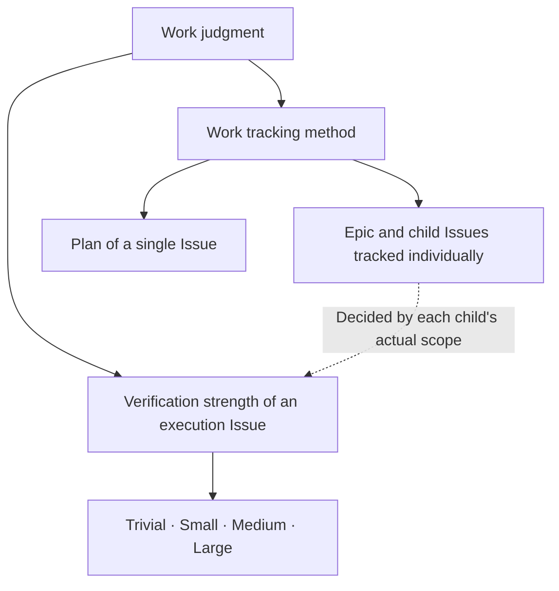

# SDD epic

For the owner and needed phase of common open questions and for human judgment, apply [issue](issue.md). Apply that Issue's [grade](grade.md) and [entry](entry.md) only when starting a child execution.

## Epic management unit

Choose an Epic when several Issues need to be assigned, tracked and coordinated individually. If the work can be managed with a single Issue's plan, it can be carried out as one Large. You may create the Epic first or group work during investigation; neither order is fixed as mandatory. Parallel execution and creating a separate integration Issue are not mandatory either.

An Epic keeps in the existing Issue body the final goal, overall acceptance criteria and common guidance; child responsibilities and dependencies; the owner and needed timing of open questions; and the evidence and owner for confirming overall completion. The management document states `Work type: Epic` and is not given an execution grade. Actual code and design changes are assigned to execution Issues that have their own grade.

Do not stack an independent review gate or the Large procedure onto Epic creation or decomposition. Remote publication of the decomposition and A/B PASS are not required as conditions for starting child work. The author self-checks for missing goals, responsibility gaps, dependency contradictions and the owners of open questions. **Open questions themselves do not block starting investigation of a child Issue.** A predecessor dependency is placed only on the implementation, integration or deployment phase that needs the conclusion. The conditions of the investigation itself, such as existing human judgment and access permissions, are kept.

Common design, contracts, data/permission rules and transition order that must be reviewed together are included in the scope and acceptance criteria of the responsible execution Issue. Its grade and verification are set to include application and compatibility for the related consuming work and transition impact during deployment; splitting does not lower the verification strength of a common change. A separate common design or integration Issue does not always need to be created.

Within the delegated scope, the owning Agent updates the work composition, responsibilities and dependencies to achieve the goal. Boundaries of active work are adjusted after communicating the change and its impact to the related owners and resolving claim conflicts. Deleting or reducing goals or acceptance criteria, changing existing human decisions, and choices outside the delegation follow the existing human-judgment rules. Do not close an Epic only by collecting child completion marks; confirm the evidence that the original overall goal was achieved. Do not require implementation PRs, CI, SDD or claims as closing conditions of the management document itself.

### Transition of existing Epics

An existing `grade:Epic` is no longer used as an execution grade. If it is kept as a management document, change its work type to Epic and remove the grade. If it is kept as a single execution Issue, decide one of the four grades from the actual overall change scope. Preserve the existing goals, human decisions, merge authority and valid verification evidence; do not reset in-progress work or repeat analysis and reviews already done only because of the transition. `min_grade: Epic` in the project's automatic escalation mapping is also changed explicitly to an execution grade based on the actual risk, not substituted automatically.
