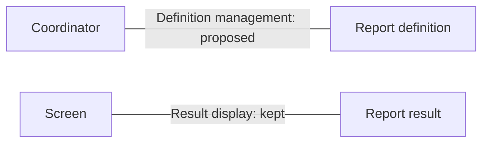
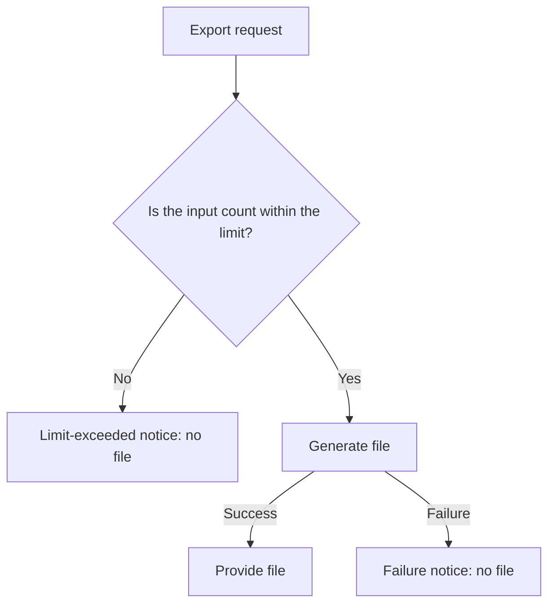

# Examples of human-facing Issue and SDD writing

These are **synthetic, illustrative cases** that apply the [visual writing criteria](agent-instruction-policy.md#visual-writing-of-human-facing-documents). They are not requirements, code observations, decisions, approvals or verification results of a real product. The cases below are independent of each other, and their fictional numbers and policies are not product defaults. Consult only the section needed for the current writing; do not preload the whole set of examples.

| What to explain now | Section to consult |
| --- | --- |
| A simple fix whose meaning does not change | [One sentence](#simple-change) |
| A responsibility change with an unchanged execution order | [Responsibility comparison in an Issue](#issue-ownership) |
| Branching by input | [Required flow diagram](#issue-flow) |
| The current problem and the investigation scope | [AS-IS](#sdd-as-is) |
| The state after the change and the choices | [TO-BE](#sdd-to-be) |
| A difference in meaning between a figure and the body text | [Existing review](#review-check) |

## Simple change — what changes?

Change the label of the help link from 'Previous help' to 'Help'. The link target and behavior stay the same.

This explanation can be used as the goal as it is. There is no need to create a figure, a comparison table or an SDD, or to fill in a reason for omitting a figure. The Priority, grade, work boundaries and acceptance criteria of a real Issue are written with the existing rules.

## Responsibility comparison in an Issue — who owns the definition?

**Synthetic user impact:** report display and definition management sit in the same component, which makes it hard to tell who is responsible for definition changes.

**Synthetic goal:** move the responsibility for managing report definitions from the screen to the coordinator, while the screen keeps the display responsibility. The call order, input/output behavior, states and UI layout do not change.

| Responsibility | Synthetic premise of the current state | Proposal | Boundary to keep / open item |
| --- | --- | --- | --- |
| Managing report definitions | Screen | Coordinator | Definition content and query results stay the same |
| Displaying results | Screen | Screen | Layout, interaction and state presentation stay the same |
| Responsibility for handling a definition lookup failure | Uninvestigated | Open | Do not settle that implementation before the responsibility is decided |

If this table alone shows the responsibility difference well enough, do not add a figure. When the connections between several parties are needed for the judgment, the **proposed static responsibility relationship** can be supported as below. A line is not a call or a time order. The responsibility for handling failures remains open in the table.

On the premise that all five flow conditions are false, the relationship diagram is optional. If a required condition such as call order, branching or states appears in a real Issue, apply the [Mermaid creation conditions](issue-writing-guide.md#mermaid-creation-conditions) again. Do not hide open cost or failure responsibilities only in the execution specification, and do not use this case as an implementation approval.

## Required flow diagram — what happens past the limit?

**Independent synthetic change:** add a branch that rejects the whole processing when the number of inputs exceeds the limit. Within the limit, the file is generated; when the limit is exceeded or generation fails, no file is published. There is no automatic retry. The actual value of the limit is open; until it is decided, do not settle this branch as an implementable policy.

Because the execution path splits by condition from one input, Mermaid is required. The preceding sentence explains the key condition when the diagram is not rendered, but it does not replace the required figure.

Cancellation and leaving the screen are uninvestigated. If they affect the judgment in real work, record when they are needed and the investigation scope as open items. The figure above does not decide that behavior.

## AS-IS — how does the user notice a failure?

**Synthetic premise of the following current-state/plan pair:** when file generation fails, there is no result link but also no error notice, so the user can hardly tell that it failed. The 'confirmed' entries below are constructed fictional investigation results, not verification run against a real product.

| Current relationship/behavior | Status in the synthetic case | Meaning needed for the design |
| --- | --- | --- |
| When the generator succeeds, the screen shows a result link | Set as a confirmed fact | The success path is to be kept |
| When the generator fails, the screen shows no link | Set as a confirmed fact | A failed file is not published as a success |
| In the failure state, the screen shows no error notice | Set as a confirmed fact | Direct target of this problem |
| Users may repeat the request because there is no notice | Hypothesis | Actual frequency and cause are not measured |
| State handling on cancellation or leaving the screen | Uninvestigated | Needs separate investigation before that behavior changes |

**Scope of direct evidence:** this synthetic case has no real files, symbols or logs. In a real AS-IS, connect each 'confirmed fact' above to the investigated revision and direct code/verification evidence, and leave what could not be confirmed as uninvestigated. Do not fill the evidence with verbatim conversations with people or fake source paths.

Cost and usage frequency are not measured, and it cannot be concluded that adding a failure notice alone reduces repeated requests. The uninvestigated cancellation behavior is not evidence of the effect of this error notice.

## TO-BE — what changes when a failure notice is added?

**Synthetic proposal for the AS-IS above:** when file generation fails, show a failure notice on the screen. Keep the behavior of providing the file on success and not publishing a failed file.

| Situation | Synthetic premise of the current state | Proposed result |
| --- | --- | --- |
| Generation succeeds | File link shown | File link still shown |
| Generation fails | Neither link nor notice | Failure notice shown without a link |

**D-001 — Show a failure notice on the screen.** Compared with the alternative that only shows that there is no result, this gives a clue that distinguishes a failure. The accepted cost is implementing and verifying the failure state and the accessibility notice; the actual effort is not estimated. Automatic retry or adding a new-request button is not part of this decision.

**Boundaries and failures to keep:** when generation fails, do not expose a partial file or an earlier successful file as this request's successful result. Distinguish the screen's responsibility for showing the error from the generator's responsibility for providing the result. The actual behavior of the existing cancellation and screen-leaving paths is uninvestigated and is not settled by this proposal. If the investigation shows that adding the notice affects that behavior, present the impact and the choice again before implementation.

**Open:** the actual error notice text and its accessibility presentation must be decided before it is applied. While it is open, current-state investigation and test design are possible, but the final UI presentation is not settled. Improvement in human understanding is not measured.

| Acceptance criterion | Evidence intended to check it | Current limit |
| --- | --- | --- |
| A presentation exists that makes a failure distinguishable on the screen | Compare the notice and the absence of a link with a failing input | Synthetic expectation; real implementation and verification not run |
| Successful results are provided as before | Compare the result link and output policy with a succeeding input | Needs the existing product baseline revision |
| Adding the notice creates no automatic retry | Check that no additional request occurs after a failure | Execution result not yet obtained |

The Agent execution specification references D-001 and connects the actual target file/symbol, callers, failure fixtures, verification commands and results. Because no real product was investigated here, do not make up paths or check successes. Do not duplicate the reasons for the choice in the change plan, and do not use this example alone to waive whether a real product needs an HTML Visual Spec.

## Existing review — was an automatic retry after failure introduced?

**Independent synthetic review input:** the baseline body text says 'on failure there is no result; retry happens only when the user makes a new request'. The draft figure connects 'failure → automatic retry → generating'. The cancellation behavior is uninvestigated.

| Evidence | Difference in meaning and impact | Required handling |
| --- | --- | --- |
| The body says user request; the figure says automatic retry | Who makes the request after a failure and whether extra executions happen differ | Fix the figure to match the baseline body. To propose an automatic retry, apply the existing Decision/scope procedure |
| Cancellation is uninvestigated | An unreviewed behavior cannot be assumed to be handled normally | Keep the open item and the time the investigation is needed |

Do not pass a figure because it exists or because its syntax is valid. After the fix, check in the same existing review that the answers about changes, responsibilities, failures and open items agree across the body, tables and figures. Distinguish a successful link/format check, an actual reviewer finding the mismatch, and an actual observation of human understanding. This example itself is not the execution result of any verification.
