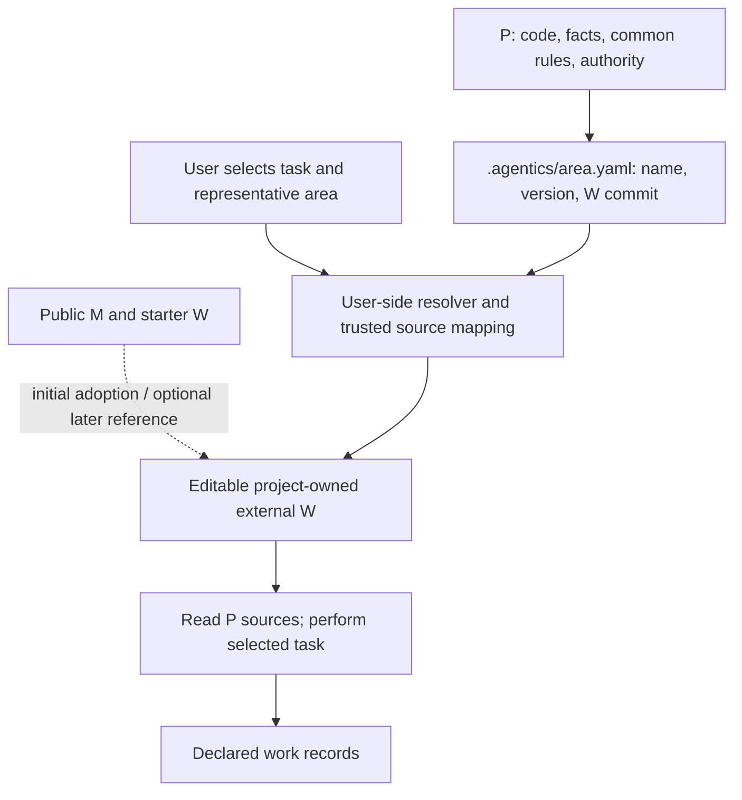

# Project-owned W adoption — 1.0

M is the public methodology offered as a starting point. After applying it, keep adapting W and P to your project. Continuing to use M, tracking its revisions or accepting its updates is the user's choice, not a requirement. [한국어](../ko/docs/customization.md).

Version 1.0 provides a **read-only resolver plus an agent-assisted adoption procedure**. It is not an automatic migration or session manager. Start from the published `v1.0.0` tag and verify its commit before deriving your project W.

## Structure and responsibility



```text
product/                       shared P
  src/ tests/ docs/             product facts and decisions
  AGENTS.md                    existing common rules, if used by the team
  .agentics/default.yaml       optional connection only
team-workflow/                 separate project-owned Git repository
  profile.json                 P references, entry, record ownership
  workflow/                    editable skills and procedures
  methodology/                 adopted local supports, editable with W callers
  project/*.md                 method choices and references to P originals
  LICENSE                      retain the starter's MIT notice
user-config/agentics.json      local source allowlist, machine-specific paths
work-records/                  chosen tracker/repository, not the distribution
```

Records may instead use an existing tracker or an explicitly chosen P path; a new evidence repository is not required. A trial connection may remain local. Adoption creates no AGENTS/CLAUDE block, product-local skill or product setting. Team common instructions remain effective without selecting the method.

## First adoption

1. Obtain and review the distribution from a trusted source at a full Git commit. Matching a downloaded manifest to itself is not source authentication. Review the loader's provenance too: it is executable code. Python 3.8+ and Git 2.36+ are required; use `python3` on POSIX or `python`/`py -3` on Windows.
2. Create a separate project-owned Git repository outside P. Copy `adaptive-sdd/workflow/`, `adaptive-sdd/methodology/` and `adaptive-sdd/LICENSE` as a starting point (Korean: `ko/adaptive-sdd/`). Do not run `install.py init/render` or copy its generated entries into P.
3. Adapt W and create external `project/*.md` application documents before their consuming steps. The starter's nine roles are `agent-instruction-policy`, `build`, `execution-routing`, `issue-priority`, `issue-writing-guide`, `module-boundaries`, `sdd-workflow`, `skill-evals`, `tracker`. Use `templates/project/*.md.tmpl` as a field checklist, not approved settings. These documents are directly editable in this path.
4. Keep product facts, required tests, approval authority, delegations and model bans tied to their approved P originals. Put grading, review depth, workflow routing and extra method-specific judgment points in W. Where P documents do not exist, distinguish code/CI observations, inference and proposed rules. Confirmed product decisions enter P through ordinary product changes; method adoption grants no authority to approve them.
5. Create the external profile below. Confirm work-record location, access, retention responsibility and revision relation before application begins. Choose additional SDD locations at their consuming stage; reuse prior declarations. If missing, stop only dependent work and ask; never silently write into P or require a new external repository. Keep product evidence out of the public distribution.
6. Review and commit project W in its own repository. Set its origin and the user's allowlist. Add `.agentics/<area>.yaml` to P with the **W commit**, not an upstream M commit. This connection is the only adoption-created P file; it does not select W for every task.

Suggested setup request:

```text
Use this reviewed public methodology as a starting point for an external project-owned W.
Keep P facts, common rules and authority in P. Adapt W to this project; do not assume
continued upstream M use or synchronization. Follow the 1.0 adoption guide.
Show procedure choices and unresolved authority/record-location decisions before using them.
Create only the selected .agentics/<area>.yaml connection in P. Do not activate W yet.
```

## Connection and user allowlist

`.agentics/default.yaml` uses a restricted YAML subset: exactly three unquoted single-line scalars. Names start with a letter/digit and contain letters, digits, dots, underscores or hyphens. Blank lines and whole-line comments are allowed; nested YAML, aliases, duplicate keys and URLs are rejected.

```yaml
methodology: example-team
version: team-1
commit: <full 40-character lowercase W commit SHA>
```

Replace the placeholder with the actual SHA. `methodology` names the project method and `version` labels it; neither implies an M version. Select one representative area per task, including work crossing areas. Apply all affected areas' P rules without implicitly selecting another method.

Place this user-owned allowlist **outside P**. Replace example paths/origin with trusted values; Windows paths can use `C:/...`.

```json
{
  "schema": 1,
  "sources": {
    "example-team": {
      "root": "/absolute/path/to/team-workflow",
      "origin": "https://example.invalid/team/workflow.git"
    }
  }
}
```

The allowlist uses the effective origin after any local Git `insteadOf` URL rewriting. The resolver compares the exact origin string, HEAD, profile identity and checkout cleanliness. This checks local consistency, not remote authenticity or a signature. Trust in loader deployment, source acquisition and allowlist comes from the user. No remote fetch or connection-provided command is executed. P and W must be full local clones; partial/promisor clones are rejected before status checks, including on older supported Git versions that ignore the lazy-fetch environment flag. A cloud session provisions the same approved origin/commit under its own root and maps the same name. Symlinks, submodules, assume-unchanged/skip-worktree/sparse entries, untracked and ignored W files are unsupported: use a dedicated clean W checkout with records elsewhere. P itself may be dirty; preserve unrelated changes. The entry must be tracked, and W/support directories must contain tracked files. Git calls ignore wrapper-provided repository/index/command-line-config environment redirects while retaining user config locations. An editor folder or `.DS_Store` in W also blocks resolution; keep the dedicated checkout clean. Version 1.0 supports SHA-1 repositories with an existing commit, not unborn or SHA-256 repositories.

## External profile

```json
{
  "schema": 1,
  "methodology": "example-team",
  "version": "team-1",
  "entry": "workflow/activation.md",
  "paths": {"workflow": "workflow", "supports": "methodology"},
  "product_sources": [
    {"path": "docs/project-rules.md", "revision": "task-start", "kind": "approved-rule"},
    {"path": "docs/architecture.md", "revision": "task-start", "kind": "fact"},
    {"path": "docs/authority.md", "revision": "task-start", "kind": "authority"}
  ],
  "records": {
    "location": "existing project tracker selected by the owner",
    "retention_owner": "project team",
    "revision_relation": "link product baseline/final revision and selected W commit in each task",
    "access_failure": "stop-dependent-work"
  }
}
```

Use real P source paths; creating these exact example documents is not required. Paths are relative to their respective roots; traversal and symlinks are rejected. Kinds are `fact`, `approved-rule`, `authority`. Version 1.0 implements only `task-start`: the resolver reports P HEAD and dirty state. The agent records the actual source revision/content identity read; HEAD alone does not identify dirty content. File existence and complete record declarations do not prove actual reading, tracker access, write authority or rule execution. Check these before dependent edits. The profile selects the entry, so project owners can replace the starter instead of following public M indefinitely. `paths.workflow` is a required relative directory; `paths.supports` is a relative directory or null. The resolver emits absolute `workflow_dir` and `methodology_dir` (nullable). The supplied starter needs the copied supports; a customized W with no M callers may select null. No upstream M is required.

## Explicit task activation

In a fresh session choose the method, product, task and representative area, then run the reviewed distribution:

```text
python3 -I -B <trusted-distribution>/adaptive-sdd/tools/agentics.py --selected --fresh-session --project-root <P> --area default --task T-12 --config <user-config>/agentics.json
```

`--task` is a caller-chosen label, not necessarily a tracker ID. Use a simple provisional label such as `new-item` before creating an Issue, then record its mapping to the actual ID. Map an ID such as `#31` to a safe label such as `issue-31`. The connection is parsed only by this resolver; name/version are strings even when a general YAML parser would infer another type.

Without `--selected`, INACTIVE is returned without reading connection/config/W. Selected failures return BLOCKED (exit 2), never a substitute method. READY (exit 0) means resolution succeeded, not execution: read the entry, relevant P sources and W procedures; verify records access/authority before editing. `--fresh-session` is a caller assertion, not a host-context check or reset.

The starter's [activation contract](../adaptive-sdd/workflow/activation.md) explains W-relative documents, locally adopted M supports and compatibility meanings for legacy hard-guard/pin references. It does not require an installer-generated AGENTS section or legacy lock. Customize W and its callers together; do not modify the selected W snapshot mid-task to bypass its gates. Commit deliberate W changes and select that commit for later tasks.

Native skill installation is not required: the user can explicitly ask the agent to read the resolved entry. An optional personal loader skill should contain only selection/resolution instructions. Claude Code supports `disable-model-invocation: true`; Codex supports `policy.allow_implicit_invocation: false` in `agents/openai.yaml`. These suppress implicit invocation, not already-loaded instructions. [Claude documentation](https://code.claude.com/docs/en/skills), [Codex documentation](https://learn.chatgpt.com/docs/build-skills), checked 2026-11-06. Version 1.0 does not install or claim to test a native loader.

After retaining closing evidence, end the task's method scope. Start another task, representative area or method in a fresh session. A close message or disabling a skill cannot erase prior instructions. P authority remains in force. Selected load/access failure blocks dependent work; unselected methods never block ordinary work.

## Updates and migration

M updates are optional. Keep, adapt, partially adopt or stop consulting M at the user's discretion. Do not overwrite customized W with a public bundle. If requested, compare the selected upstream changes and decide under project authority what to incorporate. Origin notes are optional; the selected **W commit** identifies the task procedure.

W follows its own review process. Already running tasks keep their selected snapshot or explicitly hand off to a fresh session. Revocation feeds, vulnerable-version notices, automatic upgrades and host session management are not implemented. Users can remove a mapping or refuse a W commit when they decide it must no longer be used.

The [legacy guide](legacy-installation.md) and `install.py` remain for existing installations and explicit legacy use. Their generated-file and immutable-copy checks apply only to that model. Migration is a reviewed product change:

1. Inventory installed copies, generated blocks/entries, user edits, authority and evidence references. Preserve active tasks and their copies.
2. Prepare external W. Move method preferences; keep P facts and authority. Do not automatically classify all `human_judgment`/`hard_guard_extra` values as preferences.
3. Remove only verified installer-owned method blocks/entries through a normal product PR. Preserve user text and team common rules. Do not run the old renderer afterward; it recreates those files. Retire old copies only when no active task/reference needs them.
4. Add the area connection and check selected/unselected behavior in fresh sessions. Moving storage alone leaves automatic activation intact and is not a completed migration.

Existing P overlays that require M procedures before every edit also need classification and relocation. This release does not migrate any existing product repository.

For the optional snapshot helper in external adoption, use `adaptive-sdd/tools/review_snapshot.py` from the reviewed distribution or copy it into `tools/` in the W repository. Include the legacy external connection `.agentics/adaptive-sdd.json` in the migration inventory and retire it as an installer-owned file only after active references no longer need it.

## Task-local outputs and host controls

Declare authorized write roots and a task-specific scratch/cache/output location. Product, external W, records and scratch have different permissions; selected W stays read-only during the task. Point temporary paths and language cache/compiler outputs there, and use the existing host sandbox to restrict other writes. Check any host default that also permits OS temp paths. First verify a harmless outside write is denied and an inside write succeeds; if it fails, provision an isolated runtime or explicitly report enforcement as unconfirmed. This distribution does not install an OS sandbox and resolver READY does not enforce file access. Routine Trivial/Small tasks use the selected W's `workflow/process/small-work.md`.

When the sandbox runs as a different OS account, verify Git access and the declared compiler/runtime under that account before implementation. If Git reports dubious ownership, confirm the exact test/project repositories and configure only those trusted paths in a session-specific Git config; do not use a wildcard or silently change the user-wide trust policy. Provision inaccessible toolchains in an authorized readable location rather than disabling the sandbox.
