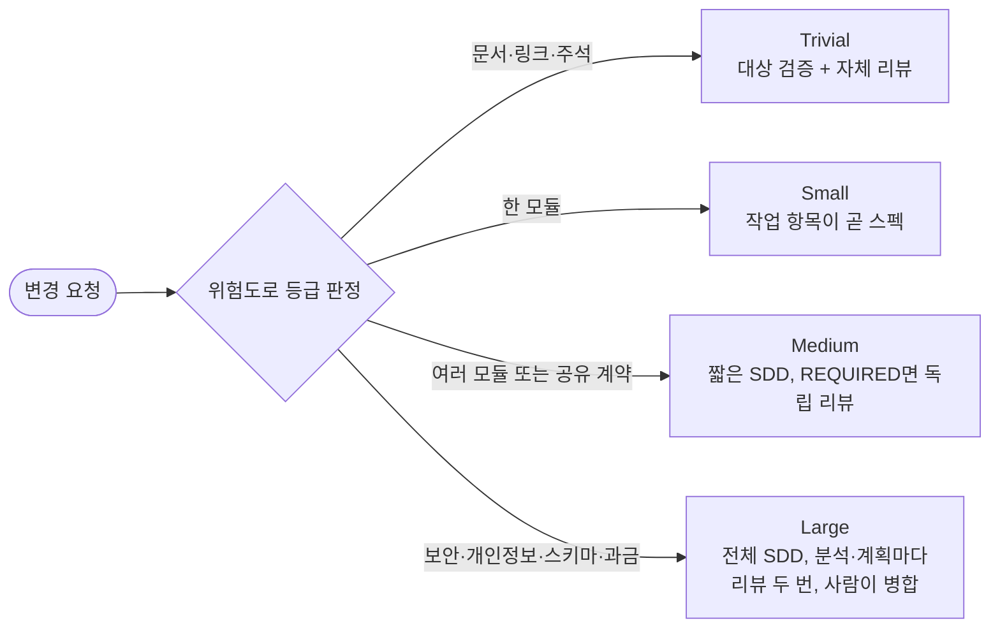

# Adaptive Agentic SDD

**오타와 마이그레이션을 구분하는 스펙 주도 개발.**

AI 코딩 Agent(Claude Code나 Codex)가 변경마다 먼저 위험도로 등급을 매기고, 그 위험에 필요한 절차만 수행합니다. 링크 수정은 자체 점검으로 끝나고, DB 마이그레이션은 분석과 계획 문서를 쓰고, 각각 독립 리뷰를 두 번씩 받은 뒤 사람이 병합합니다.

[](https://github.com/seok-jun/adaptive-agentic-sdd/releases) [](../LICENSE)

[English](../README.md) | **한국어**

> **정식 릴리스: [v1.1.0](https://github.com/seok-jun/adaptive-agentic-sdd/releases/tag/v1.1.0).** 기존 코드베이스용입니다. 결과·재작업·비용에 대한 효과는 아직 측정하지 않았습니다. [상태와 근거](#상태와-근거)를 보세요.

이 판의 파일은 저장소의 `ko/` 아래에 있습니다. 영문판이 원본이며, 두 판의 뜻이 다르면 영문이 기준입니다.

**[빠른 시작](#빠른-시작) · [깊이가 어떻게 달라지나](#깊이가-어떻게-달라지나) · [들어 있는 것](#들어-있는-것) · [근거](#상태와-근거)**



## 빠른 시작

### 1분 체험

```bash
git clone https://github.com/seok-jun/adaptive-agentic-sdd
python3 adaptive-agentic-sdd/try/setup.py --lang ko
```

Windows에서는 `python`을 쓰세요(Windows의 `python3`는 Microsoft Store를 여는 경우가 많습니다).

```powershell
git clone https://github.com/seok-jun/adaptive-agentic-sdd
python adaptive-agentic-sdd/try/setup.py --lang ko
```

설정은 1분 정도 걸립니다. 지금 있는 폴더에 `adaptive-sdd-try/`가 생기고, 그 안에 작은 예제 제품, 팀 워크플로, 로컬 Git 원격, 작업 기록 폴더가 만들어집니다. 그 폴더 밖에는 아무것도 쓰지 않고 네트워크도 쓰지 않습니다. `adaptive-sdd-try/START-HERE.md`를 열고 거기 적힌 명령으로 Claude Code나 Codex를 시작한 뒤, 미리 심어 둔 세 과제 중 하나를 맡겨 보세요. README 깨진 링크(Trivial), 페이지네이션 버그(Small), 비밀번호 저장(Large)입니다. 과제 하나는 Agent가 몇 분 동안 진행합니다. 끝까지 마치도록 로컬 원격에 대한 `git commit`, `merge`, `push`와 `records/` 안의 파일 수정을 허용해 주세요.



실제 Codex 실행 두 건을 줄인 것입니다(영문판). [실행 기록과 한계](../docs/eval-results/2026-11-07-try-sandbox/README.md)를 참고하세요.

### 내 프로젝트에 적용

**1. 프로젝트에서 Claude Code나 Codex를 열고 다음을 붙여 넣습니다.**

```text
https://github.com/seok-jun/adaptive-agentic-sdd/blob/v1.1.0/ko/docs/customization.md 를 읽고
이 프로젝트에 Adaptive SDD를 적용하도록 도와줘. 파일을 쓰기 전에 매번 물어봐.
```

Agent가 [적용 가이드](docs/customization.md)를 따라 함께 설정합니다. Agent 지원 구성이며 무인 설치기가 아닙니다. Python 3.8+와 Git 2.36+가 필요합니다.

**2. 설치 후 구조.** 제품 저장소에는 세 줄짜리 파일 하나만 추가됩니다. 워크플로 자체(스킬, 절차, 프로젝트 선택을 담은 Markdown 파일 수십 개)는 팀이 소유하고 수정하는 별도 저장소에 둡니다. 아래에서 P는 제품 저장소, W는 워크플로 저장소입니다.

```text
your-product/                 기존 제품 저장소(P)
├─ src/ tests/ docs/          그대로
├─ AGENTS.md                  그대로. 구간을 추가하지 않음
└─ .agentics/default.yaml     새 파일: 워크플로 commit 연결
team-workflow/                새 저장소: 팀이 소유하는 Git 저장소(W)
├─ profile.json               P 원본과 작업 기록 위치
├─ workflow/                  스킬 4개와 절차, 수정 가능
├─ methodology/               채택한 핵심 원칙
├─ project/*.md               프로젝트 선택: 빌드, tracker, 등급, routing ...
└─ LICENSE                    시작본 MIT 고지 보존
user-config/agentics.json     새 파일: 로컬 허용 목록, 두 저장소 밖에 둠
work records                  GitHub Issue 또는 직접 고른 위치
```

```yaml
# your-product/.agentics/default.yaml
methodology: example-team
version: team-1
commit: <W commit 전체 40자 SHA>
```

**3. 새 세션에서 첫 작업을 실행합니다.**

```text
새 세션이야. 프로젝트 W <이름>, 대표 영역 default, 작업 label new-item을 선택해.
적용 가이드의 resolver를 실행하고 READY일 때 입구를 읽어.
<작은 변경> 작업 항목을 만들고 임시 label과 실제 ID 대응을 기록한 뒤,
선택한 프로젝트 W로 구현하고 종료해 줘.
```

워크플로를 선택하지 않은 세션은 절차 파일을 전혀 읽지 않으며, 팀 공통 지침은 그대로 동작합니다. 자세한 내용: [자세한 설정](#자세한-설정).

## 왜 Adaptive SDD인가

스펙 주도 개발은 GitHub Spec Kit, Kiro 같은 도구로 코딩 Agent에서 널리 쓰이게 됐고, 코드 앞에 스펙과 계획을 둡니다. 모든 변경에 같은 전체 절차를 돌리면 작은 수정이 형식에 묻히고, 건너뛰면 위험한 변경이 리뷰 없이 지나갑니다. Adaptive SDD는 이 판단을 변경마다, 문서로 정한 규칙에 따라 내립니다.

- **절차는 파일 수가 아니라 위험에 비례합니다.** Agent는 자동 격상을 스스로 낮추지 못합니다.
- **사람이 정할 일에서 Agent가 멈춥니다.** 범위 축소, 위임, Large 병합, 새 제품 결정은 추측하지 않고 묻습니다.
- **제품 저장소가 깨끗하게 유지됩니다.** AGENTS/CLAUDE 구간이나 P 스킬을 추가하지 않습니다. 프로젝트에는 작은 `.agentics/<영역>.yaml` 연결만 남고, 누군가 작업에 선택했을 때만 절차를 읽습니다.
- **기존 코드베이스에 맞췄습니다.** 소유 모듈 테스트를 먼저 실행하고 근거가 있을 때만 검사를 넓힙니다. 작업은 GitHub Issue·PR이나 공유 폴더로 관리합니다.
- **근거는 채점된 그대로 공개합니다.** 실패도 포함합니다.

## 실제 흐름

설명을 위해 줄인 예시입니다. 실제 출력은 프로젝트 설정에 따라 다릅니다.

```text
나:    docs/setup.md의 깨진 링크를 고쳐 줘. Adaptive SDD로.
Agent: T-12를 만들었습니다. 등급: Trivial — 문서만 바뀌고 동작 변화 없음.
       T-12를 claim했습니다(허용 경로: docs/setup.md).
       링크를 고치고 대상이 열리는지 확인했습니다.
       자체 리뷰: diff가 요청 범위와 맞습니다.
       [IMPLEMENTATION SUMMARY] 기록. 병합 준비 완료, 병합 뒤 claim 해제.
```

```text
나:    payments 테이블에 환불 사유 컬럼을 추가해 줘. Adaptive SDD로.
Agent: T-31을 만들었습니다. 등급: Large — DB 스키마·마이그레이션(자동 격상).
       현재 코드와 스키마로 AS-IS 분석을 썼습니다.
       AS-IS Review A: PASS. Review B(블라인드): 리뷰 모델을 골라 주세요.
       ...
       PLAN 리뷰 통과. 허용 경로 안에서 구현했습니다.
       모듈 테스트 먼저, 최종 후보에서 필수 검사: PASS.
       독립 코드 리뷰: PASS. Large 변경은 직접 병합하거나 이 병합을 명시적으로 지시해 주셔야 해서 여기서 멈춥니다.
```

## 깊이가 어떻게 달라지나

모든 실행 작업 항목은 네 등급 중 하나를 받습니다(작업 항목을 묶는 선택적 Epic은 등급이 없습니다). 아래 등급은 제공된 시작본을 선택했을 때의 설명이며 모든 파생 프로젝트 W의 의무가 아닙니다.

| 등급 | 언제 | 설계 문서 | 구현 전 리뷰 | 변경 리뷰 |
| --- | --- | --- | --- | --- |
| **Trivial** | 실행 동작·계약·테스트·빌드·작업 흐름의 의미가 바뀌지 않음(오타, 링크, 주석) | 없음 | Trivial 조건 자체 점검 | 대상 검증 + 자체 리뷰 |
| **Small** | Trivial이 아니고, 한 모듈 안이며, 격상 조건이 없음 | 없음. 작업 항목이 곧 스펙 | 경계·검증 가능성 자체 리뷰 | 완료 기준 대비 자체 리뷰 |
| **Medium** | 두 개 이상의 모듈, 또는 프로젝트가 지정한 공유 계약 | SDD: 짧은 문서 네 개, 또는 프로젝트가 `condensed`를 고르면 한 장 | 범위를 정한 자체 리뷰. `REQUIRED`면 독립 리뷰 | `REQUIRED`면 독립 리뷰, 아니면 자체 리뷰 |
| **Large** | 보안, 개인정보, DB 스키마·마이그레이션, 백그라운드 재시도·스케줄, 과금·한도 | SDD: 문서 네 개 | AS-IS와 PLAN마다 Review A + 기본값으로 사람이 모델을 고르는 블라인드 Review B(프로젝트가 리뷰 1회로 바꾸거나 B 모델을 Agent가 고르게 할 수 있음) | 독립 코드 리뷰 1회. 사람이 병합하거나 그 병합을 명시적으로 지시 |

검증에 영향을 주는 변경 파일마다 그 파일을 소유한 모듈의 테스트를 먼저 실행하고, 근거가 있을 때만 넓힙니다. 문서만 바뀌는 Trivial은 그 변경에 맞는 대상 검증을 합니다. 필수 검사는 최종 후보에서 실행하며, 입력이 바뀌지 않은 PASS만 다시 씁니다. 정의: [등급](adaptive-sdd/workflow/process/sdd/grade.md), [리뷰 관문](adaptive-sdd/workflow/process/verification.md).

## 자세한 설정

아래에서는 세 이름을 씁니다. **P**는 제품 저장소, **W**는 프로젝트가 소유하는 워크플로 저장소, **M**은 이 저장소에서 공개하는 방법론입니다.

**M으로 시작하고, 이후 W·P는 프로젝트가 소유하고 발전시킵니다.** M의 지속 적용과 업데이트는 선택입니다. 권장 외부 적용 경로는 수정 가능한 프로젝트 W를 P 밖에 두고 선택한 작업에서만 읽습니다. P는 제품 사실·공통 규칙·권한을 보유하고 방법론 연결은 `.agentics/<영역>.yaml`뿐입니다.

1. [적용 가이드](docs/customization.md)로 외부 프로젝트 W를 준비하고 P 원본 참조와 기록 책임을 정합니다. Agent 지원 구성 절차이며 무인 설치기가 아닙니다.
2. W를 검토·commit하고 사용자 허용 목록에 이름을 매핑한 뒤 영역 연결에 그 commit을 씁니다. **프로젝트 W**의 식별이며 공개 M의 지속 추적 의무가 아닙니다.
3. 새 세션에서 작업·영역을 명시적으로 선택합니다. 가이드의 읽기 전용 `tools/agentics.py`를 실행하고 입구와 기록 접근을 확인한 뒤 편집합니다. 미선택이면 방법론 파일을 읽지 않고 선택 후 실패하면 의존 작업을 멈춥니다.

새 경로는 AGENTS/CLAUDE 구간이나 P 스킬을 쓰지 않습니다. 연결은 활성화가 아닙니다. 가이드에 구조도·스키마·커스터마이징·[이전 절차](docs/customization.md#업데이트와-이전)가 있습니다. 기존 `install.py` 설치는 [기존 계약](docs/legacy-installation.md)으로 유지하며 자동 이전하지 않습니다.

제공된 시작본을 그대로 선택했을 때, 작업 항목에 등급과 완료 기준이 있고, 첫 수정 전에 claim을 잡았고, 소유 모듈 테스트를 먼저 실행한 뒤 최종 후보에서 필수 검사가 통과했고, `[IMPLEMENTATION SUMMARY]`에 결정·검증·남은 위험이 남았고, 변경 요청이 작업 항목에 연결되면 병합 준비가 끝납니다. 병합 주체는 설정을 따릅니다. Agent가 실제 병합을 확인하고 작업 항목을 닫고 제품 완료를 기록하면(`[PRODUCT COMPLETE]`, Trivial/Small은 종료 기록의 한 항목) 완료입니다. 프로젝트 필요와 실제 작업 관찰에 맞춰 W를 발전시키며 공개 M은 선택적 참고로 남습니다.

## 들어 있는 것

- **스킬 4개:** `managing-issues`(작업 항목 생성·등급), `parallel-development`(claim과 격리된 worktree), `implementing-issues`(등급별 설계와 구현), `finishing-issues`(검증·종료·정리).
- **일반 작업용 간결 경로:** Trivial·Small 작업은 스킬 4개를 미리 모두 읽지 않고, 읽을 문서가 정해져 있고 기록이 세 개(claim, 요약, 종료)인 [절차 하나](adaptive-sdd/workflow/process/small-work.md)를 따릅니다. 필수 검증·claim·병합 권한은 Medium과 같습니다.
- **작업 관리:** GitHub Issue·PR, 또는 저장소 밖 공유 폴더의 작업 문서. 절차는 특정 도구에 묶이지 않는 용어를 쓰고, 각 [어댑터](adaptive-sdd/workflow/tracker/)가 대응시킵니다. 다른 도구용 어댑터는 아직 없습니다.
- **사람 판단 경계:** 범위 축소, 위임, Large 병합, 새 제품 결정은 Agent가 정하지 않고 멈춰서 묻습니다([core.md](adaptive-sdd/methodology/core.md)).
- **읽기 전용 작업 resolver**(`tools/agentics.py`, Python 표준 라이브러리와 Git): 영역 선택·사용자 출처 매핑·W commit을 확인합니다. 기존 설치기는 별도로 선택하는 기존 모델에 남습니다.
- **평가 도구:** 스킬마다 행동 사례, 도구 간 실행기, 기록된 사건을 시험 사례로 바꾸는 규칙([skill-evals.md](adaptive-sdd/workflow/process/skill-evals.md)).

## 상태와 근거

- **측정하지 않음:** 결과·재작업·비용에 대한 효과는 측정하지 않았습니다. 절차는 한 제품에서 다듬었고, 그것이 다른 곳에서의 효과를 증명하지는 않습니다.
- **1.1.0 Small 전후 비교:** 같은 Small 과제를 버전마다 Codex로 3회씩 실행해 6회 모두 병합과 claim 해제까지 마쳤습니다. 재정의 후 기록은 7개에서 3개로, Agent가 받은 명령 출력은 3분의 1 줄었습니다. 입력 토큰은 8% 줄었고 소요 시간 차이는 보이지 않았습니다. 과제 하나, Agent 하나의 결과입니다 — [기록](../docs/eval-results/2026-11-07-small-redesign/README.md).
- **1.0.1 일반 작업 시험:** 합성 단일 모듈 Small 작업 다섯 개(Python, JavaScript, TypeScript, Java, Go)를 Codex로 실행해 구현, 필수 검사, 로컬 병합, 종료, claim 해제까지 마쳤고, 독립 clone으로 동작과 범위를 확인했습니다. 첫 시도는 다섯 중 셋이 완료됐고, 나머지 둘은 환경 문제로 멈춘 뒤 범위를 정한 수정 후 완료했습니다. 속도·비용 비교는 아닙니다 — [기록](../docs/eval-results/2026-11-06-small-route/README.md).
- **행동 평가:** 첫 도구 간 기준선으로 한국어 사례 12개 × Claude Code·Codex × 3회를 실행했습니다(Claude Code PASS 21 / FAIL 14 / INVALID 1, Codex PASS 22 / FAIL 14) — [기록](../docs/eval-results/2026-10-30/README.md). 문구 수정 두 개를 사후 짝 비교한 결과 전체 개선은 관찰되지 않았습니다 — [기록](../docs/eval-results/2026-10-30-skill-comparison/paired-summary.md). 실패도 채점된 그대로 공개합니다. 기준선과 preview.6 작업 관리 확인에서는 평가 대상 프로젝트 안에서 정답 사례 파일을 읽을 수 있었으므로 깨끗한 근거가 아닙니다. 짝 비교에서는 그 파일을 제거했습니다.
- **보장이 아님:** Agent와 사람을 위한 안내이며, 보안 경계나 Agent 실행기가 아닙니다.

<details>
<summary>이전 검사(preview.7, 모델 routing, runner v2)</summary>

- **이전 preview.7 검사:** Windows·Python 3.12.2에서 실행 테스트 89개가 모두 통과했고, 두 번들 manifest(각 66개 파일)가 일치했으며, 리뷰한 후보(`0a65db9`)의 압축본이 두 판 × 두 작업 관리 방식 모두에서 `init`, `render`, `check`, `check-evals`(사례 83개)를 통과했습니다. 읽기 전용 독립 리뷰(Codex `gpt-6-astra`, high)는 출시 차단 문제 없이 P2 1건을 지적했고 README 샌드박스 안내에서 고쳤습니다. 선택 사항인 P3 문구 제안 2건은 반영하지 않았습니다.
- **이전 preview.7 macOS 호환성:** preview.7은 생성되는 POSIX 검사 명령이 `python3`를 쓰도록 고쳤습니다. 같은 Mac에서 `python` 명령 없이 수정 커밋 `4986f1e`를 다시 실행해 테스트 89개가 모두 통과했습니다([보고](https://github.com/seok-jun/adaptive-agentic-sdd/pull/6#issuecomment-6541138071)). 앞선 보조 walkthrough에서는 설치, Small 작업, Undo를 완료했으며, 최초 실패와 호환 alias를 사용한 진단은 [기록](../docs/eval-results/2026-10-31-macos-first-use/README.md)에 있습니다. 사전 정보 없는 독립 첫 사용 평가는 아닙니다. 실제 GitHub tracker 작업은 실행하지 않았습니다.
- **모델 routing(c′ 정책 완화):** 저장소 소유자가 승인한 변경으로, [routing 적격 규칙](adaptive-sdd/workflow/skills/_shared/execution-routing.md#두-축-routing)을 따르는 일반 Trivial/Small 작업의 현재 모델·수동 선택 경로에서는 역량을 입증하는 근거를 요구하지 않습니다. 그 밖의 현재 모델·수동 선택 경로에는 최신 호스트 근거나 관찰 결과를 인용해 사람이 확인한 범위 한정 평가가 필요합니다. 자동 전환·위임·대체 경로에는 여전히 PASS가 필요합니다. 역량 표가 비어 있는 Codex 첫 사용 실행에서 Small 작업을 처음부터 끝까지 완료했습니다([기록](../docs/eval-results/2026-10-31-first-use/README.md)). 이것이 결과·재작업·비용에 대한 효과를 입증하지는 않습니다.
- **Runner v2:** 평가 대상 번들에서 정답 파일을 제외합니다. 합성 답변 11개로 한 채점기 보정에서는 두 채점기를 합쳐 132/132개 항목이 일치했습니다([기록](../docs/eval-results/2026-10-31-grader-calibration/README.md)). c′ 행동 확인 결과는 PASS 5 / FAIL 9 / INVALID 2였고, 채점된 14회에서 `must_not` 위반은 없었습니다. 모든 Codex 평가 실행에서 파일을 읽지 못했고 정상 진행 사례에 Issue ID가 없어 약한 근거입니다. 이번 릴리스에서는 runner를 고치지 않았고 조건을 새로 고정한 실행도 하지 않았습니다([기록](../docs/eval-results/2026-10-31-routing-cprime/README.md)).

</details>

검사와 리뷰의 전체 이력은 [CHANGELOG.md](../CHANGELOG.md)에 있습니다.

## 버전

- 1.1.0은 Small이 Medium의 안전장치를 유지하면서 Trivial 수준의 기록만 남기게 합니다. 읽을 문서가 정해져 있고 일반 기록은 세 개입니다. 워크플로 문서를 외부 적용 방식에 맞추고 첫 사용 수정도 포함합니다. [릴리스 기록](../docs/releases/1.1.0.md)을 참고하세요. 기존 프로젝트 워크플로는 자동 갱신되지 않습니다.
- 1.0.2 패치는 1분 체험 샌드박스, README 빠른 시작과 데모, 이슈 양식을 더하고 평가 실행기가 Claude Code 세션 기록을 남기게 합니다. 배포본은 1.0.1과 같습니다. [릴리스 기록](../docs/releases/1.0.2.md)을 참고하세요.
- 1.0.1 패치는 Trivial/Small 간결 경로와 명시적 임시·출력 경계를 추가합니다. [패치 검증과 한계](../docs/releases/1.0.1.md)를 참고하세요. 기존 프로젝트 워크플로는 자동 갱신되지 않습니다.
- 1.0은 preview.8에서 준비한 프로젝트 소유 외부 W와 명시적 작업 활성화 모델을 채택합니다. [릴리스와 검증 기록](../docs/releases/1.0.0.md)을 참고하세요. 과거 평가는 새 활성화 경로의 검증이 아닙니다.
- 정식 태그는 `v1.1.0`이며 과거 preview는 `v1.0.0-preview.N`을 사용합니다. 공개한 태그는 옮기지 않고, 수정은 새 버전 태그로 냅니다. 기존 설치 사본은 태그·commit SHA·manifest 해시로 고정하며 외부 적용은 선택한 프로젝트 W commit으로 식별합니다.
- W는 프로젝트 권한으로 발전시킵니다. M 업데이트는 선택이며 수정한 W를 덮어쓰지 않습니다. 기존 설치는 [자체 이전/업그레이드 안내](docs/legacy-installation.md)를 따릅니다.
- 이전 v0.2 방법론(영문)은 태그 [`v0.2.0`](https://github.com/seok-jun/adaptive-agentic-sdd/tree/v0.2.0)에 있습니다. v1은 v0.2에서 자동으로 업그레이드되지 않습니다.

## 기여

Issue와 PR을 환영합니다. [CONTRIBUTING.md](../CONTRIBUTING.md)를 참고하세요. Adaptive SDD가 도움이 됐다면 ⭐ 하나가 다른 사람이 이 프로젝트를 찾는 데 도움이 됩니다.

## 라이선스

[MIT](../LICENSE)
