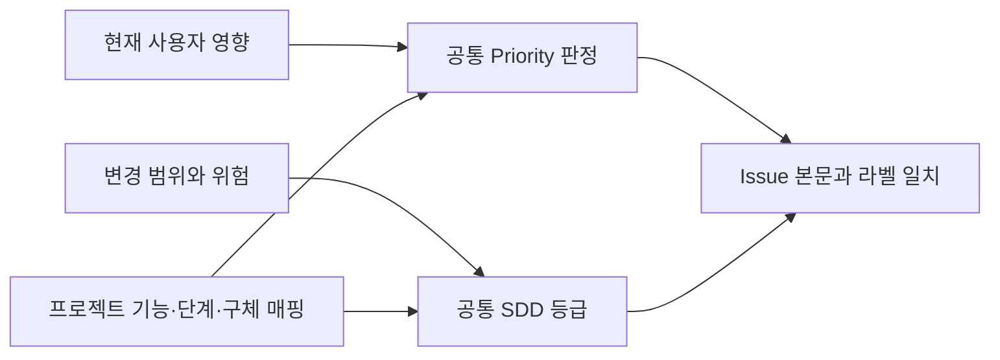

# 공통 이슈 우선순위와 분류 규약

이 문서는 프로젝트에 공통으로 적용하는 Priority 판정·증거 부족 처리·본문/라벨 규약의 원본이다. Priority는 현재 사용자 영향에 따른 처리 순서이고, SDD grade는 변경 규모·위험에 따른 절차 깊이다. 서로 대체하지 않는다. 프로젝트는 핵심 기능·현재 단계·구체적인 적용 조건과 검증 명령을 소유한다.



## Priority 판정 순서

신규 Issue는 **P0 → P1 → P2 → P3** 순서로 검사하고 처음 일치하는 값을 사용한다. 핵심 기능과 현재 사용 가능 목표는 해당 프로젝트 문서에서 확인한다.

| Priority | 공통 판정 |
| --- | --- |
| P0 — Blocker | 기본 진입이 실패하거나, 핵심 흐름이 전면 실패하고 정상 우회가 없거나, 사용자 데이터 손실·손상·잘못 덮어쓰기가 실제 발생/재현 가능하거나, 비밀정보가 노출되거나, migration 실패로 기존 사용을 계속할 수 없음 |
| P1 — Usable | P0은 아니지만 핵심 흐름의 반복 실패로 일상 사용이 어렵거나, 현재 실사용 필수 기능을 사용할 수 없거나, 요청한 핵심 콘텐츠가 생성돼도 열기·확인·사용할 수 없거나, 반복 수동 복구가 필요하거나, 합리적 우회 없이 핵심 기능 자체를 포기해야 함 |
| P2 — Normal | P0/P1은 아니고 현재 사용에 실제 불편이 있지만 우회 또는 정상 복구가 가능함 |
| P3 — Backlog | P0/P1/P2가 아니고 현재 사용자 기능의 성공/실패에 영향을 주지 않음 |

단순히 중요하거나 빨리 처리하고 싶다는 선호는 P0 근거가 아니다. 데이터 손실·보안 노출처럼 위험이 확인된 변경을 개발 편의라는 이름으로 P3에 넣지 않는다. Priority는 현재 영향이고 grade는 변경 위험이므로 높은 grade가 곧 높은 Priority를 의미하지 않는다.

## 증거가 부족할 때

- P1인지 P2인지 판단할 증거가 없으면 **P2**로 기록한다.
- 현재 사용자 영향이 있는지조차 확인되지 않으면 **P3**로 기록한다.
- Priority를 높이는 새로운 증거가 생기면 `사용자 영향`을 구체적으로 갱신한 뒤 Priority와 라벨을 함께 변경한다.

`P1 후보`, `아마 P0`, `높아 보임` 같은 중간 상태를 Priority 값으로 사용하지 않는다.

## 같은 Priority의 처리 순서

같은 Priority끼리는 다음 순서로 선택한다.

1. 다른 P0/P1 Issue를 차단 해제하는 Issue
2. 더 낮은 SDD grade
3. 현재 활성 lane과 수정 경로가 겹치지 않는 Issue
4. 위 조건까지 같으면 Issue 번호가 작은 것

## 신규 Issue 필수 본문

신규 구현/버그 Issue는 다음 항목을 모두 포함한다.

사람용 설명은 [시각적 작성 기준](agent-instruction-policy.md#사람용-문서의-시각적-작성)에 따라 핵심 변화부터 쓴다. 아래는 필수 항목의 최소 골격이며, 비교표·관계/흐름·Visual Spec의 선택과 작성 예시는 [상세 이슈 템플릿](issue-writing-guide.md#issue-본문-구조)을 따른다. 필수 항목을 늘리거나 단순 변경에 그림을 요구하지 않는다.

```md
## Priority
P1

## SDD grade
Medium

## 사용자 영향
- 누가 어떤 상황에서 겪는 문제인지 검증 가능한 한 문장

## 목표
- 해결 후 관찰 가능한 핵심 변화. 비교가 판단에 필요하면 상세 템플릿의 전후·책임 표현을 선택

## 작업 범위
- 포함하는 동작

## 작업 경계
수정 허용:
- 실제 확인한 수정 허용 경로
수정 금지:
- 실제 확인한 수정 금지 경로

## 제외 범위
- 이번 Issue에서 하지 않는 동작

## 완료 기준
- [ ] 통과/실패를 판정할 수 있는 조건

## 의존성 / 차단 요소
없음
```

`현재 동작을 개선한다`, `UX를 좋게 한다`, `필요한 코드를 수정한다`처럼 합격 기준이나 수정 대상을 특정할 수 없는 문장을 목표·범위·완료 기준으로 사용하지 않는다.

## 필수 라벨

신규 Issue는 생성 직후 다음 라벨을 **각각 정확히 하나** 가져야 한다.

- Priority: `priority:P0`, `priority:P1`, `priority:P2`, `priority:P3`
- SDD grade: `grade:Trivial`, `grade:Small`, `grade:Medium`, `grade:Large`, `grade:Epic`

agent가 Issue 생성 API에서 두 라벨을 함께 지정할 수 있으면 생성 요청에 포함한다. API 제약으로 한 번에 적용되지 않으면 생성 직후 보정하고, 다시 조회해 두 라벨이 확인되기 전에는 완료로 보고하지 않는다.

본문 값과 라벨이 다르면 임의로 라벨을 우선하지 않는다. 판정 근거를 다시 확인한 뒤 **본문과 라벨을 같은 값으로 수정한다.**

## Priority 변경

Priority를 변경할 때는 한 번의 정리 작업에서 다음을 모두 갱신한다.

1. Issue 본문의 `Priority`
2. `사용자 영향`
3. 기존 `priority:*` 라벨 제거
4. 새 `priority:*` 라벨 추가

Priority 변경만으로 SDD grade를 바꾸지 않는다. 구현 범위가 달라졌을 때만 이 방법론의 `process/sdd-workflow.md` 공통 등급과 프로젝트별 적용 조건로 grade를 다시 판정한다.

프로젝트의 구현 queue·착수 가능 Priority는 해당 프로젝트의 현재 단계 조건을 따른다. 선행 관계나 grade만으로 Priority를 승격하지 않는다.
