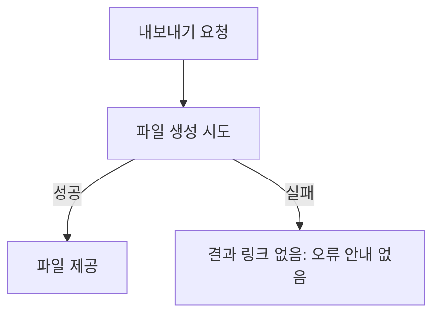
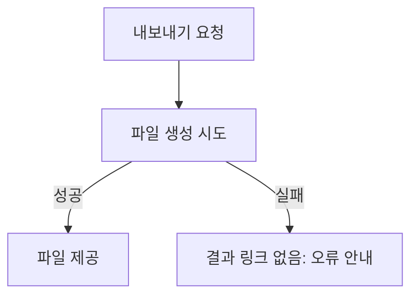

# issue-writing-guide 수행 절차

조건·제품 사실·필수 검증·사람 권한은 P 적용 문서 `W/../project/issue-writing-guide.md`가 원본이다. W는 공통 분류 기준과 수행법을 소유한다.

공통 Priority·SDD grade와 본문/라벨은 [공통 우선순위](issue-priority.md) 및 [공통 등급](sdd/grade.md#sdd-grade)을 따른다. 제품별 적용과 권한은 P 원본을 함께 읽는다.

## 표현 수단의 역할

Issue의 사람용 설명에는 [사람용 문서의 시각적 작성](agent-instruction-policy.md#사람용-문서의-시각적-작성)을 적용한다. 목표·핵심 변화부터 보여주고, 정책·전후 차이는 작은 비교표, 소유·책임·시스템 경계는 관계도나 경계 표로 설명할 수 있다. 아래 Mermaid 생성 조건에 해당하지 않아도 필요한 비교·관계 설명은 적용한다. 단순 변경은 한 문장으로 충분하며 그림 개수를 채우지 않는다. UI HTML의 생성 조건과 제품 저장 위치·의존성 제한은 그대로다.

| 대상 | 표현 | Source of Truth 역할 |
| --- | --- | --- |
| 목표, 정책, 범위, 완료 기준 | Markdown Issue 본문 | 기능 동작과 작업 범위 |
| 처리 순서, 분기, 상태 전이 | Mermaid | Issue 본문의 동작 흐름 시각화 |
| 정적인 소유·책임·시스템 경계 | 경계 표 또는 선택적 Mermaid 관계도 | 실행 순서와 구별한 관계 설명 |
| UI 배치, 정보 계층, 화면 상태 | HTML Visual Spec | UI/UX 구현 기준 |

HTML은 UI/UX에만 사용한다. provider routing, 데이터 흐름, business process, module architecture를 HTML로 작성하지 않는다.

## Mermaid 생성 조건

아래 조건 중 하나라도 참이면 Issue 본문에 Mermaid를 넣는다. 이 경우 문장·비교표만으로 필수 흐름도를 대체하지 않는다.

1. 기존 처리 단계의 순서가 바뀐다.
2. 하나의 입력에서 조건에 따라 두 개 이상 실행 경로로 분기한다.
3. WorkManager, retry, polling, queue 같은 비동기 흐름을 추가·삭제·변경한다.
4. 구현 완료 기준이 두 개 이상 상태 사이의 전이를 요구한다.
5. 세 개 이상 컴포넌트/모듈의 호출 순서가 변경된다.

위 조건이 모두 거짓이면 흐름도를 의무로 만들지 않는다. 정적인 소유·책임·시스템 연결·경계가 판단 대상이면 경계 표 또는 Mermaid 관계도를 선택할 수 있다. 관계도의 선에는 `정의 소유`, `결과 공개 책임`처럼 관계의 의미를 적고, 실제로 없는 호출 순서·상태 전이를 암시하지 않는다. 단순 변경이 한 문장으로 이해되거나 표로 관계가 충분히 드러나면 그림을 추가하지 않아도 된다.

형식은 다음 규칙으로 선택한다.

- 순차 처리/조건 분기: `flowchart`
- 컴포넌트 호출 순서: `sequenceDiagram`
- 상태와 이벤트 전이: `stateDiagram-v2`
- 정적 소유·책임·시스템 관계: 경계 표 또는 연결 의미를 표시한 `flowchart`. 정적 관계라는 설명을 붙인다.

같은 흐름을 자연어와 Mermaid로 중복해서 길게 설명하지 않는다. Mermaid로 순서를 보여주되, 렌더링 없이도 판단에 필요한 핵심 관계·조건·실패·미결은 인접한 짧은 문장이나 표에서 읽을 수 있게 한다. 전체 노드·화살표를 산문으로 복제하지 않는다. [정적 책임](visual-writing-examples.md#issue-ownership)과 [필수 흐름](visual-writing-examples.md#issue-flow) 중 현재 작성에 필요한 예시만 참고한다.

## HTML Visual Spec 생성 조건

P 적용 문서 `issue-writing-guide.md`가 Visual Spec 저장소를 선언하지 않았으면 이 절과 아래 HTML·디자인 PR·Visual Spec 링크 절은 적용하지 않는다. 그때 UI 변경은 Mermaid·표·짧은 설명으로 보여주고, HTML이 반드시 필요한 요청이면 `BLOCKED: visual spec storage undeclared`로 보고한다.

HTML Visual Spec은 **사용자가 보거나 조작하는 UI/UX 변경**이고 아래 조건 중 하나라도 참일 때 생성한다.

1. 신규 화면을 만든다.
2. 기존 화면에 새로운 주요 영역을 추가하거나 기존 주요 영역을 제거한다.
3. navigation, modal, bottom sheet, picker, gallery, tab 구조를 추가·삭제·변경한다.
4. 두 개 이상 주요 UI 영역의 상대 위치 또는 정보 계층을 바꾼다.
5. 완료 기준이 default/loading/empty/error/disabled 중 두 개 이상 화면 상태의 서로 다른 표현을 요구한다.
6. 사용자가 명시적으로 화면 디자인, mock, wireframe, Visual Spec을 요구한다.

위 조건이 모두 거짓이면 HTML을 생성하지 않는다.

다음 변경만 있는 경우 HTML을 생성하지 않는다.

- 문구 변경
- 단일 색상/간격/아이콘 변경
- 기존 위치가 정확히 지정된 버튼 하나의 추가/삭제
- UI에 노출되지 않는 로직 수정
- 기존 레이아웃을 유지하는 버그 수정

agent가 "디자인이 있으면 좋을 것 같다"는 이유만으로 HTML을 추가하지 않는다. 위 조건으로만 판정한다.

## HTML 최소 내용

Visual Spec은 다음 항목을 포함한다.

1. 앱 Issue 번호와 제목
2. 변경 대상 화면 이름
3. 기존 화면과 변경 화면을 둘 다 비교해야 하면 `Current`와 `Proposed`
4. 주요 영역의 위치와 정보 계층
5. 완료 기준에 포함된 모든 UI 상태
6. 사용자가 실행할 주요 action과 action 이후 화면 상태

Visual Spec은 앱 기능을 재구현하는 프로토타입이 아니다. 네트워크, DB, 실제 provider 동작을 JavaScript로 흉내 내지 않는다.

## 디자인 PR 병합·배포·정리

디자인 `main`은 검증된 시안을 공유·보관하는 곳이다. HTML 또는 앱 Issue의 Visual Spec에 초안/설계 상태를 명시한다. **디자인 PR 병합은 앱 설계 승인·구현 착수 승인·제품 구현 완료가 아니다.** 기존 grade별 승인과 공개 제한은 그대로 적용하며 이 절은 새 사람 승인 단계를 추가하지 않는다.

최초 이슈 생성과 이후 Visual Spec 수정 모두 같은 작업 안에서 다음을 수행한다.

1. HTML의 standalone 구조, 주요 화면/상태, 외부 asset/API 미사용과 기존 공개 가능 정보 규칙을 확인한다. P가 선언한 디자인 저장소의 검사 명령과 PR 필수 검사를 통과한다. 원문·비공개 정보가 있거나 기존 승인/보호 조건이 충족되지 않으면 게시를 진행하지 않는다.
2. 디자인 PR에 앱 Issue를 일반 링크로 연결하고, 앱 Issue에는 고정 HTML 링크와 디자인 PR을 함께 남긴다. 디자인 PR에 앱 Issue를 닫는 `Closes`를 넣지 않는다.
3. 해당 HTML commit을 디자인 main 이력에 보존하는 방식으로 PR을 병합한다. 자동 squash/rebase로 고정 근거를 교체하지 않는다. 병합 직전에 원격 head와 전체 변경 목록을 확인하고, 경쟁 변경은 검증·승인 범위를 다시 확인한다.
4. main의 해당 변경을 포함한 미리보기 배포(P 선언. 예: GitHub Pages) 성공과 개별 미리보기 접근을 확인한다. 미리보기 URL은 편의 링크이며 구현 기준의 immutable permalink를 대체하지 않는다. HTML만 바꾼 후속 commit도 새 고정 링크를 연결하고 같은 절차를 반복한다. 이미 앱 승인에 연결된 기준의 변경은 기존 승인 규칙을 따른다.
5. 병합과 고정 permalink의 접근 가능성, branch 현재 tip의 main 포함, 미커밋·미게시 변경 및 다른 active 작업 부재를 확인한다. 작업 소유의 local worktree가 있으면 생성 출력을 정리하고 clean 상태에서 제거한 뒤 registration/physical directory 부재를 확인한다. 그 뒤 병합된 local/remote 작업 branch를 삭제하고 부재를 확인한다. 기본 branch, 미병합 commit, 출처 불명 파일 또는 다른 active 작업은 보존한다.
6. 앱 Issue의 Visual Spec에 디자인 PR·배포/미리보기·branch 정리 상태를 기록한다. 이후 수정은 당시 디자인 main에서 새 branch로 시작한다. 과거에 남은 branch도 이름이나 오래된 merged PR만 보고 지우지 않고 5번의 현재 상태로 판정한다.

과거에 이미 squash/rebase 병합된 branch는 tip의 commit ancestry가 main에 없을 수 있다. 이 경우에만 **현재 remote tip = 당시 merged PR의 head**, **병합 commit의 main 포함**, **PR 전체 변경 목록과 병합 diff의 동일성 및 해당 파일의 병합 당시 내용 일치**를 모두 직접 확인해 병합 근거로 대신한다. 고정 permalink가 있으면 삭제할 branch와 독립된 ref(예: 해당 PR의 head ref)가 원래 commit을 보존하며 링크에 접근할 수 있음을 삭제 전에 확인한다. 미커밋/미게시·active 작업 확인을 생략하지 않고, 정리 후에는 branch 부재와 원래 commit/permalink 접근을 다시 확인한다. 사전 근거가 다르거나 증명되지 않으면 남겨두고, 사후 확인이 실패하면 정리 미완료로 기록해 복구한다. 새 시안의 commit 보존 병합 원칙을 바꾸는 예외로 사용하지 않는다.

PR 검증·병합·배포·미리보기·정리 중 하나라도 실패하면 마지막 성공 단계와 남은 작업, PR/branch를 기록하고 **Visual Spec 게시/정리 미완료**로 보고한다. 실패를 숨기거나 강제 삭제하지 않고 복구 후 남은 단계부터 재개한다. 이 상태만으로 기존 immutable HTML을 무효화하거나 앱 이슈를 자동 종료하지 않으며, 앱 구현 가능 여부는 기존 이슈/승인 계약으로 판단한다.

## Issue 본문 구조

신규 구현/버그 Issue는 [공통 필수 본문](issue-priority.md#신규-issue-필수-본문)을 유지하며 다음 순서를 사용한다. 사용자 영향·목표는 핵심 변화부터 설명한다. 아래 대괄호 안내를 실제 내용으로 교체하고 해당하지 않는 선택적 표·흐름 절은 생략한다. [단순 변경](visual-writing-examples.md#simple-change)은 한 문장으로 충분하며, [책임 비교](visual-writing-examples.md#issue-ownership)는 그 차이가 판단에 필요한 경우만 사용한다.

````md
## Priority
P1

## SDD grade
Medium

## 사용자 영향
[누가 어떤 상황에서 겪는 문제인지 먼저 한 문장으로 설명]

## 목표
[해결 후 관찰 가능한 핵심 변화 한 문장]

<!-- 전후·정책·책임 비교가 판단에 필요한 경우만 사용 -->
| 판단 대상 | 현재 확인한 상태 | 변경 후 제안 | 유지할 경계·미결 |
| --- | --- | --- | --- |
| [동작 또는 책임] | [확인한 사실] | [달라지는 결과] | [예외 또는 미결] |

## 현재 흐름
<!-- 아래 두 그림은 오류 안내를 추가하는 합성 분기 예시. 실제 Issue의 흐름으로 교체 -->


## 변경 흐름

[그림을 보지 못해도 판단할 핵심 변화·실패·미결을 짧게 설명. 예: 실패 시 파일을 공개하지 않는 동작을 유지하고 오류 안내를 추가한다. 재시도 정책은 이번 변경에서 바꾸지 않는다.]

## Visual Spec
- HTML 생성 조건에 해당할 때만 추가

## 작업 범위
- ...

## 작업 경계
수정 허용:
- ...
수정 금지:
- ...

## 제외 범위
- ...

## 완료 기준
- [ ] ...

## 의존성 / 차단 요소
없음
````

다섯 흐름 조건이 모두 거짓이면 `현재 흐름`/`변경 흐름` 절을 생략한다. 정적 관계 설명을 선택한 경우에는 목표 또는 해당 범위 설명 가까이에 표/관계도를 둔다. HTML 생성 조건에 해당하지 않으면 `Visual Spec` 절을 생략한다.

## 근거 기록 규칙

근거는 원본을 복제하기보다 원본 위치·식별자·확인 revision·판정 범위를 연결한다. 허용 metadata/내용·보호 대상은 P hard guard와 제품의 근거 기록 정책을 따른다. write 전 금지 내용을 점검하고 write 후 실제 artifact를 확인한다. 재현이 필요하면 같은 구조의 합성 fixture를 사용한다. 제품이 금지한 데이터를 일반 template/예시로 옮기지 않는다.

M `core.md`의 `요구사항과 결정 기록`에 따라, 사람이 제공한 외부 티켓·작업 요구와 명시적으로 확정한 결정은 대화로 전달됐어도 Issue의 목표·범위·완료 기준과 결정 기록에 필요한 만큼 정리한다. 제공된 요구는 원천 ID·revision 또는 제공 시점과 연결하고, 결정은 내용·범위·결정자·시점·원천 참조를 남긴다. 원문 조회 불가는 한계로 표시하며 대화 전문을 복사해 근거를 대신하지 않는다. 사실 확인 요청은 조사 항목, 제안은 미확정 선택지로 유지한다. 모호한 답을 결정으로 추정하지 않고 필요한 판단만 확인한다. 명확한 결정을 다시 승인받는 단계는 추가하지 않는다.

## Visual Spec 링크 규칙

HTML이 필요한 Issue는 다음 순서로 처리한다.

1. 앱 Issue를 생성해 Issue 번호를 확보한다.
2. 프로젝트가 별도로 선언한 디자인 저장소 원격/기준 브랜치의 freshly fetched SHA에서 격리한 작업 branch를 만들고 프로젝트가 지정한 디자인 저장소의 Issue HTML을 생성·검증·commit한다. 기존 branch를 이어 쓰면 미게시 변경과 active 작업 여부부터 확인한다.
3. commit SHA가 포함된 immutable permalink를 확보한다.
4. 앱 Issue 본문에 `## Visual Spec`을 추가한다.
5. 구현 시작 전에 링크가 immutable permalink인지 확인한다.
6. 위 `디자인 PR 병합·배포·정리`를 마친 뒤 Visual Spec 등록 완료를 보고한다. 앱 구현 완료까지 디자인 branch를 보관하지 않는다.

Issue 본문 형식:

```md
## Visual Spec
- HTML: https://github.com/<owner>/<design-repository>/blob/{commit-sha}/<project-path>
- 기준: 이 commit의 HTML을 UI/UX 구현 기준으로 사용
```

`.../blob/main/...` 링크는 초안 작성 중에만 사용할 수 있다. 구현 lane을 시작할 때는 반드시 commit permalink로 교체한다.

Visual Spec을 수정하면 새 commit permalink로 Issue 본문을 갱신한다. 이전 permalink를 그대로 둔 채 구현자가 최신 `main`을 추정하게 하지 않는다.

## Source of Truth 충돌

- 기능 동작, 데이터 처리, validation, error policy가 Issue와 HTML에서 다르면 **Issue 본문**을 따른다.
- 화면 배치, 정보 계층, 완료 기준에 명시된 UI 상태 표현이 Issue와 연결된 immutable HTML에서 다르면 **HTML Visual Spec**을 따른다.
- Mermaid와 Markdown이 다르면 기능 정책은 Markdown을 따른다. Mermaid를 같은 작업에서 수정한다.
- Visual Spec 링크가 없거나 mutable `main` 링크만 있는 상태에서 HTML이 필수인 Issue는 구현하지 않는다.
