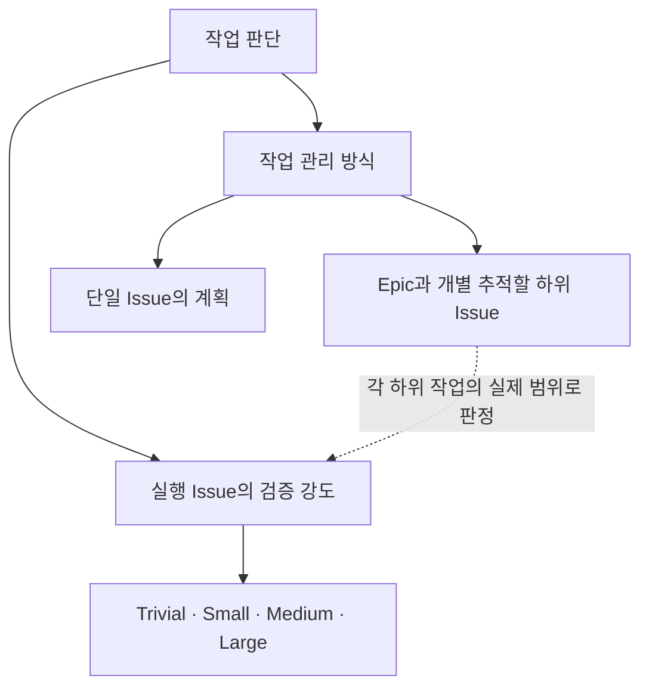

# sdd-workflow 수행 절차

공통 SDD grade·일반 자동 격상은 아래 절이 원본이다. 프로젝트 적용 선언·제품 사실·구체 검증 명령·사람 권한은 P 적용 문서 `S/.adaptive-sdd/project/sdd-workflow.md`가 원본이다. W는 공통 분류와 수행법을 소유한다.

## 현재 단계에서 읽을 규칙

이 문서는 분류·진입·Epic 관리의 원본이다. 상세 계약은 아래 담당 문서 한 곳에 두며 해당 조건과 현재 단계의 절만 읽는다. 같은 run에서 확인한 동일 버전은 재사용하고, 참조가 있다는 이유만으로 연결 문서를 모두 선행 로딩하지 않는다. P의 적용 선언·hard guard·필수 검증은 함께 적용한다.

| 조건·현재 작업 | 규칙 원본 |
| --- | --- |
| Issue 분류·파일 쓰기 진입·Epic 조율 | 이 문서의 해당 절 |
| Medium·Large의 AS-IS·PLAN 작성 | [sdd-artifacts](sdd-artifacts.md)의 작성 대상 절 |
| 완료 기준의 검증 설계·구현 중 검증·종료 | [verification](verification.md)의 현재 단계 절 |
| Large AS-IS·PLAN 검토 또는 명시적 환경 간 SDD 리뷰 | [design-review](design-review.md)의 해당 절 |
| 현재 role 진입·유지의 적격 확인, model 선택·전환·독립 reviewer 배정 | [execution-routing](../skills/_shared/execution-routing.md) |
| worker/reviewer 인계·결과 소비·구현 문맥 전환 | [execution-packets](../skills/_shared/execution-packets.md)의 해당 packet·최신성 절 |
| 시작·인계·SUMMARY·종료의 관측 | [observations](observations.md)의 현재 시점 절. 문제 사건은 실제 발견 시에만 기록 |
| P의 token mode가 ENABLED | [token-diagnostic](token-diagnostic.md)의 해당 lifecycle event |
| Skill 변경의 평가·packet 측정 | [skill-evals](skill-evals.md). 일반 구현의 선행 입력에 추가하지 않음 |

## SDD grade

실행 Issue의 grade는 다음 네 값만 사용한다. Epic은 실행 등급과 별개인 선택적 관리 단위다.

| grade | 판정 조건 |
| --- | --- |
| **Trivial** | runtime/contract/test expectation/build·dependency/schema·migration/CI·workflow 실행 의미를 바꾸지 않는 문서·문구·링크·주석·비동작 metadata 정리 |
| **Small** | Trivial이 아니며 한 구현 모듈 안에서 끝나고 아래 자동 격상 조건이 하나도 없는 변경 |
| **Medium** | 두 개 이상 구현 모듈 또는 프로젝트가 지정한 공유 contract가 바뀌지만 Large 조건은 없는 변경 |
| **Large** | 보안·개인정보·DB 마이그레이션·백그라운드 재시도/스케줄·비용/quota처럼 실패 영향이 큰 변경 |

Trivial은 **파일 수가 적다는 이유만으로 선택하지 않는다.** 다음 조건을 모두 만족해야 한다.

- 제품 runtime 동작과 사용자 관찰 결과가 바뀌지 않는다.
- public/internal contract, 테스트의 기대 동작, build/dependency, DB schema/migration이 바뀌지 않는다.
- CI, Skill, agent workflow의 실행 step·gate·stop condition 의미가 바뀌지 않는다.
- 보안·개인정보·비용·quota 정책의 의미가 바뀌지 않는다.

대표 예시는 오타/맞춤법 수정, 깨진 링크의 목적지 교정, 동작 의미를 바꾸지 않는 설명 문구·주석 정리, 현재 상태를 반영하는 비동작 metadata 갱신이다. 실행 코드·테스트·빌드 설정·workflow 실행 규칙을 바꾸거나 문서 변경 자체가 agent/product 동작을 바꾸면 최소 Small이다.

### 일반 자동 격상

여러 조건이 해당하면 가장 높은 grade를 적용한다. 프로젝트는 구체적인 모듈·기술·업무 경로를 아래 위험에 매핑하며 공통 최소 등급을 낮추지 않는다. 공유 contract 격상 대상은 프로젝트 매핑에서 지정한다. 단일 모듈의 다른 contract를 이름만으로 이 대상에 추가하지 않는다.

| 변경 행위 | 최소 grade |
| --- | --- |
| 두 개 이상 구현 모듈 또는 프로젝트가 지정한 공유 contract 변경 | Medium |
| 비밀정보·대화 원문·개인정보 저장·전송·로그 정책 변경 | Large |
| DB schema/migration 변경 | Large |
| 백그라운드 재시도·스케줄·중복 실행 방지 정책 변경 | Large |
| 과금 경로·비용 계산·quota/상한 변경 | Large |

새 패키지·모듈 신설이나 의존성 방향 변경만으로 Epic 생성 또는 작업 분해를 강제하지 않는다. 실제 변경 범위와 위 위험 조건으로 실행 grade를 판정한다.

자동 격상 기준보다 낮은 grade를 사용하려면 사용자의 명시적 예외 지시가 Issue 본문에 기록되어 있어야 한다. agent가 스스로 낮추지 않는다.

## 공통 계약과 프로젝트 적용

아래 공통 단계·리뷰·검증 계약의 원본은 W다. 프로젝트가 선언한 적용 등급/프로필·사람 권한·실제 경로와 최소 검증 명령을 함께 읽는다. 원본 이관만으로 프로젝트의 기존 gate를 늘리거나 줄이지 않는다. `P`는 현재 프로젝트, `W`는 검증한 방법론이며 이 문서의 프로젝트 경로는 P 적용 문서가 선언한 실제 경로에 대응한다. 일반 실행 순서와 형식은 아래 계약을 사용한다.

## 문서 역할

| 종류 | 위치 | 수명 | 역할 |
| --- | --- | --- | --- |
| business 문서 | `docs/domains/**` | 영속 | 구현 완료 후 유지되는 현재 제품 동작 |
| SDD 작업 문서 | `docs/sdd/{feature}/` | 작업 중 | AS-IS 근거, Human Decision Contract, Agent Execution Spec |
| 결정 기록 | `docs/reviews/**` | 영속 | 과거 의사결정의 근거와 대안 |
| 구조 문서 | `docs/architecture/**` | 영속 | 모듈 책임, 의존성, 작업 경계 |

위 위치는 기본값이며 실제 위치는 P 적용 문서의 `문서 역할` 표를 따른다. SDD 작업 문서는 완료 시 정리하되, 활성 소비자가 참조하는 근거는 [finishing의 참조 보존 조건](../skills/finishing-issues/SKILL.md#4-remove-temporary-sdd)에 따라 불변 참조로 전환하거나 담당·해제 조건을 정해 보존한다. business 문서는 SDD 문서나 Issue를 복사하지 않고 **최종 코드 동작을 읽어서** 갱신한다.

## 구현 시작 조건

읽기 전용 조사에는 수정 claim이나 새 branch/worktree를 선행 요구하지 않는다. 같은 파일을 조사하는 것은 수정 경로 충돌이 아니다. 조사 자체의 접근 권한·사용자 지시·확정된 선행 조건을 확인하고 조사 기준 revision을 남긴다.

실행 Issue의 P 저장소 작업 파일을 처음 생성·수정·삭제하기 전에는 [parallel-development](../skills/parallel-development/SKILL.md#읽기-전용-조사와-수정-진입)의 lane·claim을 확보한다. SDD·테스트·제품 코드도 포함한다. 현재 단계의 조건을 적용하므로 SDD 작성 claim에 아직 작성하지 않은 AS-IS/PLAN의 리뷰 PASS를 요구하지 않는다. tracker의 관리 기록과 Epic 관리 문서 자체는 기존 예외를 유지한다. 제품 구현에 진입할 때는 아래 조건과 해당 grade gate를 별도로 충족한다.

Trivial/Small/Medium Issue는 다음 조건을 모두 만족하면 구현을 시작할 수 있다.

- 현재 작업 지시가 해당 Issue 구현을 요청한다.
- 필수 본문 항목과 Priority/grade 라벨이 모두 존재하고 서로 일치한다.
- `status:blocked`가 없다.
- 다른 활성 lane의 `[CLAIM]` 또는 PR과 수정 허용 경로가 겹치지 않는다.
- 현재 lane이 `W/skills/parallel-development/SKILL.md`의 claim 절차를 완료했다.

조건 하나라도 충족하지 않으면 코드를 수정하지 않는다.

## grade별 산출물과 게이트

| grade | SDD 문서 | 구현 전 게이트 |
| --- | --- | --- |
| Trivial | 없음 | 범위가 Trivial 조건을 만족하는지 확인 후 진행 |
| Small | 없음 | 구현 시작 조건만 충족하면 진행 |
| Medium | 필요 | SDD 작성 후 구현까지 중간 승인 없이 진행 |
| Large | 필요 | AS-IS → required review → PLAN → required review → 구현. 사람 승인 단계 없음 |

### Trivial

별도 `docs/sdd/**` 디렉터리를 만들지 않는다. Issue 본문 또는 현재 사용자 지시가 작업 범위 역할을 하며, 대상 파일과 직접 검증 근거만 확인한다.

- repository-wide discovery를 하지 않는다.
- independent review는 요구하지 않는다.
- 변경 종류에 맞는 targeted validation과 최종 diff self-review는 생략하지 않는다.
- 빌드 도구 검증(P가 선언한 build/test 명령)은 변경이 그 결과에 영향을 주는 근거가 있을 때만 실행한다.
- 작업 중 Trivial 조건을 벗어나는 변경이 필요해지면 수정 전에 최소 Small로 재판정한다.

### Small

Issue 본문이 change plan 역할을 한다. 별도 `docs/sdd/**` 디렉터리를 만들지 않는다.

### Medium

`docs/sdd/{feature}/`를 작성한 뒤 구현을 계속한다. 별도의 중간 사용자 확인을 기다리지 않는다. 단, SDD를 작성하는 과정에서 Issue 목표·범위·경계가 서로 충돌하는 것을 발견하면 구현하지 않고 `BLOCKED`로 보고한다.

### Large

`01-as-is.md` → AS-IS required review → `02-to-be.md`·`change-plans/**` → PLAN required review → 구현으로 진행한다. [설계 리뷰](design-review.md)의 원격 후보 게시·A/B 독립성·current-target 진행 조건을 적용한다. 구현 뒤 grade별 code review와 검증을 수행하고 Large 병합은 기존 사람 판단 규칙을 따른다.

## Epic 관리 단위

Epic은 여러 Issue를 개별 배정·추적·조율할 필요가 있을 때 선택한다. 단일 Issue의 계획으로 관리할 수 있으면 하나의 Large로 수행할 수 있다. Epic을 먼저 만들거나 조사 중 작업을 묶을 수 있으며, 어느 순서도 필수로 고정하지 않는다. 병렬 실행과 별도 integration Issue 생성도 필수가 아니다.

Epic은 최종 목표·전체 완료 기준·공통 가이드, 하위 책임·의존성, 미결 사항의 담당과 필요한 시점, 전체 완료를 확인할 근거와 담당을 기존 Issue 본문에 유지한다. 관리 문서에는 `작업 유형: Epic`을 명시하며 실행 grade를 부여하지 않는다. 실제 코드·설계 변경은 자체 grade를 가진 실행 Issue에 배정한다.

Epic의 생성·분해에는 독립 리뷰 gate나 Large 절차를 누적하지 않는다. 분해 원격 게시·A/B PASS를 하위 착수 조건으로 요구하지 않는다. 작성자는 목표 누락, 책임 공백, 의존성 모순, 미결 사항의 담당을 자체 점검한다. **미결 사항 자체는 하위 Issue의 조사 착수를 막지 않는다.** 그 결론이 필요한 구현·통합·배포 단계에만 선행 의존성을 둔다. 기존 사람 판단과 접근 권한 등 해당 조사 자체의 조건은 유지한다.

함께 검토해야 하는 공통 설계·계약·데이터/권한 규칙·전환 순서는 담당 실행 Issue의 범위와 완료 기준에 포함한다. 관련 소비 작업의 적용·호환성과 배포 중 전환 영향을 포함해 grade와 검증을 정하며, 분할로 공통 변경의 검증 강도를 낮추지 않는다. 별도 공통 설계·통합 Issue를 항상 만들 필요는 없다.

담당 Agent는 위임된 범위 안에서 목표 달성을 위한 작업 구성·책임·의존성을 갱신한다. 활성 작업의 경계는 관련 담당에게 변경·영향을 전달하고 claim 충돌을 해소한 뒤 조정한다. 목표·완료 기준의 삭제·축소, 기존 사람 결정 변경, 위임 밖의 선택은 기존 사람 판단 규칙을 따른다. 하위 완료 표시만 모아 Epic을 닫지 않고 원래 전체 목표의 달성 근거를 확인한다. 구현용 PR·CI·SDD·claim을 관리 문서 자체의 종료 조건으로 요구하지 않는다.

### 기존 Epic 전환

기존 `grade:Epic`은 실행 등급으로 계속 사용하지 않는다. 관리 문서로 유지하면 작업 유형을 Epic으로 바꾸고 grade를 제거한다. 단일 실행 Issue로 유지하면 실제 전체 변경 범위로 네 등급 중 하나를 판정한다. 기존 목표·사람 결정·병합 권한·유효한 검증 근거는 보존하고, 전환만을 이유로 진행 중 작업을 초기화하거나 이미 한 분석·리뷰를 반복하지 않는다. 프로젝트 자동 격상 매핑의 `min_grade: Epic`도 실제 위험에 따른 실행 grade로 명시적으로 바꾸며 자동 치환하지 않는다.

## 기존 분석 재사용

하위 Issue의 AS-IS는 상위·관련 작업의 분석 원문과 기준 코드 revision, 적용 범위·전제, 근거를 먼저 확인한다. 현재 변경에도 유효한 사실은 참조하고 부족하거나 달라진 부분만 보완한다. phase나 문서 이름이 다르다는 이유로 같은 조사를 반복하지 않는다. 분석 재사용은 하위 Issue의 해당 grade 검토를 자동 면제하거나, 과거 검증·PASS를 새 target의 결과로 승계한다는 뜻이 아니다.

## 미결 사항과 단계별 의존성

리뷰 PASS는 해당 target에 대한 검토 결과이며 모든 결정의 완료나 다음 작업 전체의 착수 허가가 아니다. 작성자·조사·reviewer 중 누가 발견했든 미결 사항에는 **확인/결정할 내용, 담당, 결론을 필요로 하는 작업·단계**를 기존 Issue/SDD에 연결한다. 새 상태 라벨·별도 장부·질문 개수 gate는 만들지 않는다.

진입하려는 작업이 결론을 소비하면 해당 부분은 기다리고, 결론과 무관한 조사·작업은 진행할 수 있다. 예를 들어 배포 시점에만 필요한 결정은 독립적인 조사 착수를 막지 않지만, PLAN에서 동작을 선택해야 하는 질문을 배포까지 미룰 수는 없다. 미결 질문을 단순히 노출했다고 해결된 것으로 보거나, reviewer finding에 없다는 이유로 무시하지 않는다. 기존 grade별 리뷰와 사람 판단 요건은 유지한다.

여러 Issue에 공통인 질문은 Epic 담당 또는 기존 조정 담당이 원천·영향 Issue를 연결해 한 번에 묻는다. 이를 위해 Epic을 새로 만들 필요는 없다. 결정 뒤 담당은 관련 Issue/SDD의 미결 표시를 갱신하거나 확정 결정 참조로 대체하고, 활성 담당에게 전달한다. 과거 미결 기록은 이력으로 보존하되 현재 지시가 서로 다르게 남지 않도록 한다. 의미 변경이면 [계획 정정과 정책 전환](sdd-artifacts.md#계획-정정과-정책-전환)을 적용한다.

## Verification Strategy

완료 기준과 검증 수단의 대응, grade별 review, targeted·최종 검증 및 PASS 재사용은 [검증 계약](verification.md)을 따른다. 실제 명령과 프로젝트의 필수 검증은 P의 `build.md`·Issue가 정한다.

## Grade별 review gate

[등급별 review gate](verification.md#grade별-review-gate)가 원본이다. Large 설계 리뷰 순서와 재검토는 [설계 리뷰](design-review.md)에 둔다. Epic 생성·분해에 이 실행 검증을 누적하지 않는다.

## business 문서 갱신

business 문서는 구현 완료 후 **현재 코드가 실제로 하는 동작**을 기록한다.

1. 변경된 심볼의 직접 사용자/배경 진입점을 찾는다.
2. 변경으로 실제 동작이 달라진 규칙만 수정한다.
3. 변경하지 않은 규칙을 재작성하지 않는다.
4. Issue, commit message, SDD 문장을 그대로 옮기지 않는다.
5. code와 기존 business 문서가 다르면 `W/process/agent-instruction-policy.md`의 drift 규칙을 적용한다.

한 줄 규칙이 조건·예외·재시도를 모두 담아 150자를 넘으면 상세 주제 문서로 분리하고 business 인덱스에는 ID, 한 줄 요약, 링크만 둔다.

## Issue 본문 규약

신규 구현/버그 Issue의 필수 section과 canonical 본문 형식은 고정 W의 `process/issue-priority.md`의 `## 신규 Issue 필수 본문`이 Source of Truth다. 제품별 적용 조건은 `S/.adaptive-sdd/project/issue-priority.md`를 읽는다. 이 문서는 같은 template을 복제하지 않는다.

본문 값과 `priority:*`, `grade:*` 라벨은 항상 일치해야 한다.

Issue 댓글은 `[CLAIM]`, `[RELEASE]`, 변경 이력을 기록할 수 있지만 **현재 목표·범위·경계·완료 기준을 댓글로만 변경하지 않는다.** 변경이 확정되면 본문도 같은 내용으로 갱신한다.

실행 Issue의 일반 댓글은 Agent ↔ Agent 작업 소통이다. AS-IS 근거, 리뷰 반론, path/symbol, 구현 발견, test/verification, handoff를 공유하며 Human의 상시 확인을 요구하지 않는다. Agent끼리의 합의는 Human Decision이 아니며 확정된 Decision을 암묵적으로 추가·변경하지 못한다.

- `[HUMAN DECISION REQUIRED]`: 작업 지시·확정된 설계 범위를 벗어나는 새 중요한 제품/설계 Decision이 필요할 때만 사용한다. 영향을 받는 작업을 STOP하고, 해당 Decision·실제 대안·trade-off를 Human View(Medium 이상은 `02-to-be.md`, Trivial/Small은 Issue)에 반영한 뒤 Human 결정 후 재개한다. Issue의 목표·범위·경계·완료 기준도 바뀌면 본문을 함께 갱신한다.
- `[IMPLEMENTATION SUMMARY]`: 구현 종료 시 댓글 하나에 확정 Decision 준수 여부, execution deviation, Human escalation 발생 여부, verification 결과, 남은 위험만 짧게 기록한다. 추가 Human 승인 gate가 아니다.

위 `### 일반 자동 격상` 및 P 적용 문서의 `### 자동 격상`의 모든 변경 카테고리는 반드시 Human Decision에 노출한다. 제품 동작 의미, acceptance 해석, 상위 contract가 바뀌거나 의미가 다른 합리적 경쟁 대안이 발견된 경우도 포함한다. **Decision 노출 의무와 추가 Human 결정 필요 여부는 별개다.** Medium은 Issue 목표·범위·경계 안의 결정을 SDD에 명시하고 기존 gate에 따라 진행하며, 노출 카테고리라는 이유만으로 `[HUMAN DECISION REQUIRED]`를 요구하지 않는다. Escalation은 위의 작업 지시·확정된 설계 범위를 벗어나는 새 중요한 결정에 적용한다. 이미 Issue/설계가 결정한 사항에는 결정을 다시 요구하지 않는다. 확정된 제품 의미·불변조건을 바꾸지 않는 구현 세부는 Agent 재량으로 계속한다.

위 두 댓글과 일반 소통의 역할만 구분한다. 기존 claim/release/token marker와 grade별 gate는 유지하며 `[EVIDENCE]`, `[REVIEW]`, `[RESOLVED]` 같은 추가 댓글 taxonomy, 새 문서나 승인 단계를 만들지 않는다. 기존 문서의 내용을 이관해 Human 필수 읽기와 중복을 줄이고 Agent 간 작업 소통량은 인위적으로 제한하지 않는다. Medium의 추가 승인 없는 SDD 진행과 Trivial/Small의 별도 SDD 생략도 유지한다.

## Legacy Issue 정규화

아래는 실행 Issue의 정규화다. 기존 Epic 관리 문서는 위 `기존 Epic 전환`을 따르며 실행 grade·코드 경로 부재로 조율이나 하위 조사를 막지 않는다. 기존 실행 Issue에 아래 항목 중 하나라도 없으면 코드 수정 전에 Issue를 정규화한다.

- Priority 본문 값과 `priority:*` 라벨
- SDD grade 본문 값과 `grade:*` 라벨
- 사용자 영향
- 목표
- 작업 범위
- 작업 경계의 `수정 허용` / `수정 금지`
- 완료 기준
- 의존성 / 차단 요소

정규화 단계에서는 제품 코드를 수정하지 않는다. 기존 Issue의 목표와 현재 architecture 문서를 기준으로 최소 경계를 작성하고, shared 경로가 필요하면 integration 작업으로 표시한다.

## SDD 작업 문서 구조

Medium·Large의 문서 구조와 Human Decision·Agent Execution Spec의 역할은 [SDD 작업 문서](sdd-artifacts.md)를 따른다. Trivial·Small에는 별도 SDD를 만들지 않는다.

## 실행 routing과 packet

grade는 orchestration shape를 결정하고 phase risk·decision complexity는 model/reasoning tier를 결정한다.

- Trivial·Small은 current agent 한 명이 model switch/delegation 없이 끝낸다. current concrete model이 role DENIED이면 actor 수를 늘리지 않고 qualified replacement 한 명으로 교체한다.
- Medium은 단일 agent가 기본이며 unresolved PLAN decision 또는 required independent review phase만 bounded delegation한다.
- Large는 root/orchestrator가 검토를 통과한 설계와 경계를 소유하고 `PLAN / IMPLEMENT / REVIEW` phase routing을 사용할 수 있다.
- Epic의 실제 작업은 각 실행 Issue의 grade를 따르며 Epic 소속만으로 delegation·병렬 실행을 요구하지 않는다.

model capability·qualification·fallback은 [execution-routing](../skills/_shared/execution-routing.md), derived cache의 필드·guard provenance·freshness·결과 소비는 [execution-packets](../skills/_shared/execution-packets.md)가 원본이다. 해당 선택·전달 시점에 읽으며 모든 작업의 고정 선행 입력으로 추가하지 않는다.

### PLAN 확정 뒤 구현 문맥 인계

Large PLAN → IMPLEMENT는 [구현 진입의 문맥·최신성 확인](../skills/_shared/execution-packets.md#구현-진입의-문맥최신성-확인)을 따른다. 검토한 결정·직접 계약·남은 finding·검증 의무를 전달하고 첫 edit 전에 현재 근거를 확인한다.

## 차세대 방법론의 적용과 개선 관측

모든 실행 grade의 시작·인계·SUMMARY·종료 기록은 [적용·개선 관측](observations.md)을 따른다. 실제 문제 발견 시 사건을 연결하고, SUMMARY 작성 시 작성 모델을 남긴다. 관측 공백은 제품 완료의 새 gate가 아니다.

## 안정화 기간 token diagnostic

P의 mode가 `ENABLED`일 때만 [token-diagnostic](token-diagnostic.md)의 START/BLOCKED/RESUME/END를 적용한다. tracker 부재로 생략하는 범위는 token checkpoint이며 일반 관측을 함께 생략하지 않는다.

## 병렬 작업

claim/release, branch/worktree, cloud sandbox의 실행 절차는 `W/skills/parallel-development/SKILL.md`가 canonical owner다. 모듈 ownership, shared/root integration 경계는 `S/.adaptive-sdd/project/module-boundaries.md`가 Source of Truth다.

## 완료 절차

구현 후 아래 순서를 바꾸지 않는다.

1. diff를 읽고 실제 동작 변경을 확정한다.
2. 변경된 동작과 직접 연결된 business 문서를 최종 코드 기준으로 갱신한다.
3. SDD 삭제 전에 Verification Strategy에 따른 구현의 필수 검증 근거를 확인하고 누락·무효화된 검증을 수행한다.
4. P가 선언한 SDD 작업 문서 위치의 현재 작업 폴더를 [참조 보존 조건](../skills/finishing-issues/SKILL.md#4-remove-temporary-sdd)에 따라 삭제하거나 담당·해제 조건을 명시해 보존한다.
5. P 문서 목차와 다른 문서의 SDD 링크는 불필요한 것만 제거하고 활성 소비자의 필요한 참조는 유지·전환한다.
6. 관련 review 문서에 현재 상태 필드가 있으면 실제 상태와 일치하도록 갱신한다. 과거 결정 내용 자체는 다시 쓰지 않는다.
7. 예정된 저장소 파일 변경을 모두 마친 후보를 고정하고 최종 필수 검증 근거를 확보한 뒤 grade별 CODE Review/self-review를 수행한다. 종료 시 두 근거의 유효성을 함께 확인하며, 앞선 검증은 입력 불변 근거가 있을 때만 재사용한다. 상세 순서와 변경 후 재확인은 [finishing-issues의 최종 후보 확인](../skills/finishing-issues/SKILL.md#5-prepareverify-pr-closure)을 따른다.
8. `[IMPLEMENTATION SUMMARY]` 댓글 하나를 남기고 PR 본문에 `Closes #{issue-number}`를 넣는다. 요약을 검증·required review 통과의 대체 근거로 쓰지 않는다.
9. PR merge 후 Issue가 닫혔는지 확인한다.

business 문서를 갱신하기 전에 SDD 문서를 삭제하지 않는다.

완료 기준 하나라도 실패하거나 미검증이면 해당 항목을 체크하지 않고 완료 보고에 남긴다.
