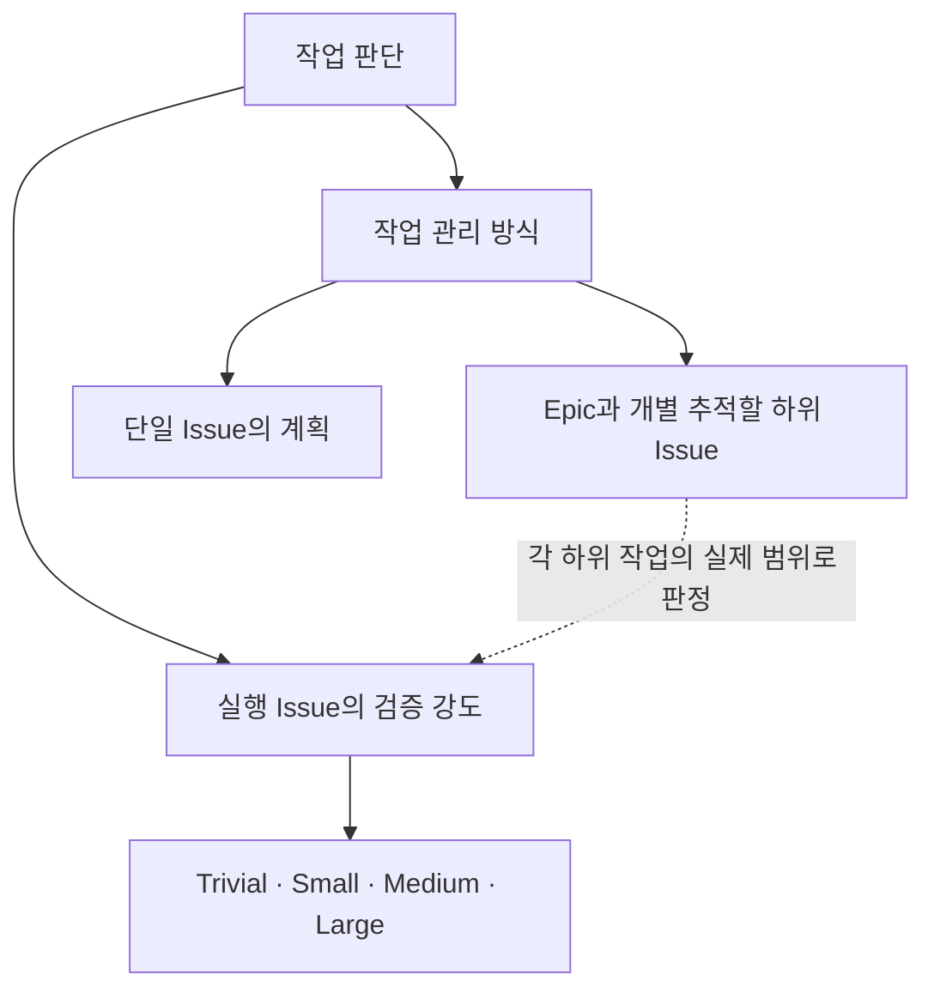

# SDD epic

공통 미결의 담당·필요 단계와 사람 판단은 [issue](issue.md)를 적용한다. 하위 실행 착수 시에만 해당 Issue의 [grade](grade.md)·[entry](entry.md)를 적용한다.

## Epic 관리 단위

Epic은 여러 Issue를 개별 배정·추적·조율할 필요가 있을 때 선택한다. 단일 Issue의 계획으로 관리할 수 있으면 하나의 Large로 수행할 수 있다. Epic을 먼저 만들거나 조사 중 작업을 묶을 수 있으며, 어느 순서도 필수로 고정하지 않는다. 병렬 실행과 별도 integration Issue 생성도 필수가 아니다.

Epic은 최종 목표·전체 완료 기준·공통 가이드, 하위 책임·의존성, 미결 사항의 담당과 필요한 시점, 전체 완료를 확인할 근거와 담당을 기존 Issue 본문에 유지한다. 관리 문서에는 `작업 유형: Epic`을 명시하며 실행 grade를 부여하지 않는다. 실제 코드·설계 변경은 자체 grade를 가진 실행 Issue에 배정한다.

Epic의 생성·분해에는 독립 리뷰 gate나 Large 절차를 누적하지 않는다. 분해 원격 게시·A/B PASS를 하위 착수 조건으로 요구하지 않는다. 작성자는 목표 누락, 책임 공백, 의존성 모순, 미결 사항의 담당을 자체 점검한다. **미결 사항 자체는 하위 Issue의 조사 착수를 막지 않는다.** 그 결론이 필요한 구현·통합·배포 단계에만 선행 의존성을 둔다. 기존 사람 판단과 접근 권한 등 해당 조사 자체의 조건은 유지한다.

함께 검토해야 하는 공통 설계·계약·데이터/권한 규칙·전환 순서는 담당 실행 Issue의 범위와 완료 기준에 포함한다. 관련 소비 작업의 적용·호환성과 배포 중 전환 영향을 포함해 grade와 검증을 정하며, 분할로 공통 변경의 검증 강도를 낮추지 않는다. 별도 공통 설계·통합 Issue를 항상 만들 필요는 없다.

담당 Agent는 위임된 범위 안에서 목표 달성을 위한 작업 구성·책임·의존성을 갱신한다. 활성 작업의 경계는 관련 담당에게 변경·영향을 전달하고 claim 충돌을 해소한 뒤 조정한다. 목표·완료 기준의 삭제·축소, 기존 사람 결정 변경, 위임 밖의 선택은 기존 사람 판단 규칙을 따른다. 하위 완료 표시만 모아 Epic을 닫지 않고 원래 전체 목표의 달성 근거를 확인한다. 구현용 PR·CI·SDD·claim을 관리 문서 자체의 종료 조건으로 요구하지 않는다.

### 기존 Epic 전환

기존 `grade:Epic`은 실행 등급으로 계속 사용하지 않는다. 관리 문서로 유지하면 작업 유형을 Epic으로 바꾸고 grade를 제거한다. 단일 실행 Issue로 유지하면 실제 전체 변경 범위로 네 등급 중 하나를 판정한다. 기존 목표·사람 결정·병합 권한·유효한 검증 근거는 보존하고, 전환만을 이유로 진행 중 작업을 초기화하거나 이미 한 분석·리뷰를 반복하지 않는다. 프로젝트 자동 격상 매핑의 `min_grade: Epic`도 실제 위험에 따른 실행 grade로 명시적으로 바꾸며 자동 치환하지 않는다.
