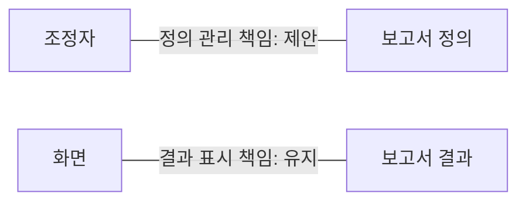
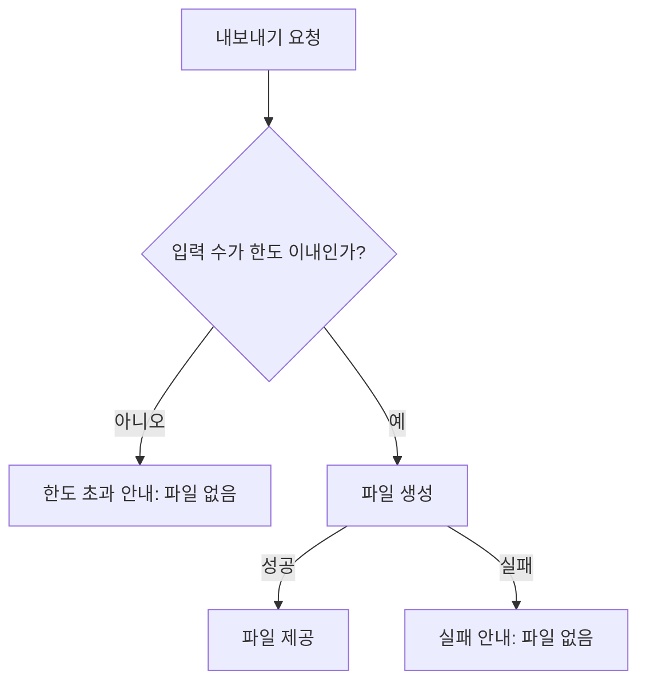

# 사람용 이슈·SDD 작성 예시

[시각적 작성 기준](agent-instruction-policy.md#사람용-문서의-시각적-작성)을 적용한 **합성·설명용 사례**다. 실제 제품의 요구·코드 관측·결정·승인·검증 결과가 아니다. 아래 사례들은 서로 독립적이며, 가상의 수치·정책을 제품 기본값으로 사용하지 않는다. 현재 작성에 필요한 절만 참고하고 예시 전체를 선행 로딩하지 않는다.

| 지금 설명할 것 | 참고할 절 |
| --- | --- |
| 뜻이 바뀌지 않는 단순 수정 | [한 문장](#simple-change) |
| 실행 순서가 그대로인 책임 변경 | [이슈의 책임 비교](#issue-ownership) |
| 입력에 따른 분기 | [필수 흐름도](#issue-flow) |
| 현재 문제와 조사 범위 | [AS-IS](#sdd-as-is) |
| 변경 후 모습과 선택 | [TO-BE](#sdd-to-be) |
| 그림과 본문의 의미 차이 | [기존 리뷰](#review-check) |

## 단순 변경 — 무엇이 달라지는가?

도움말 링크의 표시 문구를 ‘이전 도움말’에서 ‘도움말’로 고친다. 링크 대상과 동작은 같다.

이 설명은 그대로 목표에 사용할 수 있다. 그림·비교표·SDD를 만들거나 그림 생략 사유를 채울 필요가 없다. 실제 이슈의 Priority·grade·작업 경계·완료 기준은 기존 규칙으로 작성한다.

## 이슈의 책임 비교 — 누가 정의를 관리하는가?

**합성 사용자 영향:** 보고서 표시와 정의 관리가 같은 구성요소에 있어 정의 변경의 책임을 구별하기 어렵다.

**합성 목표:** 보고서 정의 관리 책임을 화면에서 조정자로 옮기고, 화면은 표시 책임을 유지한다. 호출 순서·입출력 동작·상태·UI 배치는 바꾸지 않는다.

| 책임 | 현재라는 합성 전제 | 제안 | 유지할 경계·미결 |
| --- | --- | --- | --- |
| 보고서 정의 관리 | 화면 | 조정자 | 정의 내용과 조회 결과는 유지 |
| 결과 표시 | 화면 | 화면 | 배치·조작·상태 표현은 유지 |
| 정의 조회 실패의 대응 책임 | 미조사 | 미결 | 책임을 정하기 전에는 해당 구현을 확정하지 않음 |

이 표만으로 책임 차이가 충분하면 그림을 추가하지 않는다. 여러 주체의 연결이 판단에 필요할 때는 다음처럼 **제안한 정적 책임 관계**를 보조할 수 있다. 선은 호출이나 시간 순서가 아니다. 실패 대응 책임은 표의 미결로 남아 있다.

다섯 흐름 조건이 모두 거짓이라는 전제에서 관계도는 선택이다. 실제 이슈에서 호출 순서·분기·상태 등 필수 조건이 생기면 [Mermaid 생성 조건](issue-writing-guide.md#mermaid-생성-조건)을 다시 적용한다. 비용·실패 책임의 미결을 실행 명세에만 숨기거나 이 사례를 구현 승인으로 사용하지 않는다.

## 필수 흐름도 — 한도를 넘으면 어떻게 되는가?

**독립적인 합성 변경:** 입력 수가 한도를 넘으면 전체 처리를 거절하는 분기를 추가한다. 한도 이내이면 생성하고, 초과 또는 생성 실패 때는 파일을 공개하지 않는다. 자동 재시도는 하지 않는다. 한도의 실제 값은 미결이며 결정 전에 이 분기를 구현 가능한 정책으로 확정하지 않는다.

하나의 입력에서 조건에 따라 실행 경로가 나뉘므로 Mermaid가 필수다. 앞 문장이 비렌더링 시 핵심 조건을 설명하지만 필수 그림을 대체하지는 않는다.

취소·화면 이탈은 미조사다. 실제 작업에서 판단에 영향을 주면 필요한 시점과 조사 범위를 미결에 기록한다. 위 그림은 그 동작을 정하지 않는다.

## AS-IS — 사용자는 실패를 어떻게 알아차리는가?

**다음 현황·계획 쌍의 합성 전제:** 파일 생성이 실패하면 결과 링크는 없지만 오류 안내도 없어 사용자가 실패를 구별하기 어렵다. 아래 ‘확인’은 가상 조사 결과를 구성한 것이며 실제 제품에서 실행한 검증이 아니다.

| 현재 관계·동작 | 합성 사례의 상태 | 설계에 필요한 의미 |
| --- | --- | --- |
| 생성기가 성공하면 화면이 결과 링크를 표시 | 확인한 사실로 설정 | 성공 경로는 유지 대상 |
| 생성기가 실패하면 화면은 링크를 표시하지 않음 | 확인한 사실로 설정 | 실패한 파일을 성공으로 공개하지 않음 |
| 실패 상태에서 화면의 오류 안내가 없음 | 확인한 사실로 설정 | 이번 문제의 직접 대상 |
| 안내 부재 때문에 사용자가 반복 요청할 수 있음 | 가설 | 실제 빈도·원인은 미측정 |
| 취소·화면 이탈 때의 상태 처리 | 미조사 | 그 동작을 바꾸기 전에 별도 조사 필요 |

**직접 근거의 범위:** 이 합성 사례에는 실제 파일·심볼·로그가 없다. 실제 AS-IS에서는 위 ‘확인한 사실’마다 조사한 revision과 직접 코드/검증 근거를 연결하고, 확인하지 못한 것은 미조사로 남긴다. 인물 대화 원문이나 가짜 소스 경로로 근거를 채우지 않는다.

비용·사용 빈도는 미측정이며, 실패 안내 추가만으로 반복 요청이 줄어든다고 단정할 수 없다. 미조사인 취소 동작은 이번 오류 안내의 효과를 증명하는 근거가 아니다.

## TO-BE — 실패 안내를 추가하면 무엇이 달라지는가?

**위 AS-IS에 대한 합성 제안:** 파일 생성 실패 시 화면에 실패 안내를 표시한다. 성공 시 파일을 제공하고 실패 파일을 공개하지 않는 동작은 유지한다.

| 상황 | 현재라는 합성 전제 | 제안 결과 |
| --- | --- | --- |
| 생성 성공 | 파일 링크 표시 | 파일 링크 표시 유지 |
| 생성 실패 | 링크도 안내도 없음 | 링크 없이 실패 안내 표시 |

**D-001 — 실패 안내를 화면에 표시한다.** 결과가 없다는 사실만 보여주는 대안보다 실패를 구별할 단서를 제공한다. 감수하는 비용은 실패 상태와 접근성 안내의 구현·검증이며 실제 작업량은 미산정이다. 자동 재시도나 새 요청 버튼 추가는 이 결정에 포함하지 않는다.

**유지할 경계와 실패:** 생성 실패 때 부분 파일·기존 성공 파일을 이번 성공 결과처럼 노출하지 않는다. 화면이 오류를 보여주는 책임과 생성기의 결과 제공 책임을 구별한다. 기존 취소·화면 이탈의 실제 동작은 미조사이며 이번 제안으로 확정하지 않는다. 조사에서 안내 추가가 그 동작에 영향을 주면 구현 전에 영향과 선택을 다시 제시한다.

**미결:** 실제 오류 안내 문구와 접근성 표현은 적용 전에 결정해야 한다. 미결 동안에는 현황 조사·테스트 설계가 가능하지만 최종 UI 표현을 확정하지 않는다. 사람의 이해도 향상은 미측정이다.

| 완료 기준 | 확인하려는 근거 | 현재 한계 |
| --- | --- | --- |
| 실패를 화면에서 구별할 수 있는 표현이 존재 | 실패 입력에서 안내와 링크 부재를 대조 | 합성 기대값; 실제 구현·검증 미실행 |
| 성공 결과는 기존처럼 제공 | 성공 입력에서 결과 링크·출력 정책 대조 | 기존 제품 기준 revision 필요 |
| 안내 추가가 자동 재시도를 만들지 않음 | 실패 뒤 추가 요청이 발생하지 않는지 확인 | 실행 결과를 아직 확보하지 않음 |

Agent 실행 명세에는 D-001을 참조해 실제 target file/symbol, caller, 실패 fixture, 검증 명령과 결과를 연결한다. 여기서는 실제 제품을 조사하지 않았으므로 경로·검사 성공을 만들어 넣지 않는다. 선택 이유를 change-plan에 복제하지 않으며, 이 예시만으로 실제 제품의 HTML Visual Spec 필요 여부를 면제하지 않는다.

## 기존 리뷰 — 실패 후 자동 재시도가 생겼는가?

**독립적인 합성 리뷰 입력:** 기준 본문은 ‘실패 시 결과 없음, 사용자가 새 요청을 할 때만 재시도’다. 초안 그림은 ‘실패 → 자동 재시도 → 생성 중’으로 연결돼 있다. 취소 동작은 미조사다.

| 근거 | 의미 차이와 영향 | 필요한 처리 |
| --- | --- | --- |
| 본문은 사용자 요청, 그림은 자동 재시도 | 실패 후 요청 주체와 추가 실행이 달라짐 | 기준 본문에 맞게 그림을 수정. 자동 재시도를 제안하려면 기존 Decision/범위 절차 적용 |
| 취소는 미조사 | 검토하지 않은 동작을 정상 처리로 가정할 수 없음 | 미결과 필요한 조사 시점을 유지 |

그림이 존재하거나 문법이 맞다는 이유로 통과시키지 않는다. 수정 후에는 같은 기존 리뷰에서 변화·책임·실패·미결의 답이 본문/표/그림에 일치하는지 확인한다. 링크/서식 검사 성공, 실제 reviewer의 불일치 발견, 실제 사람의 이해도 관측은 구별한다. 이 예시 자체는 어느 검증의 실행 결과도 아니다.
