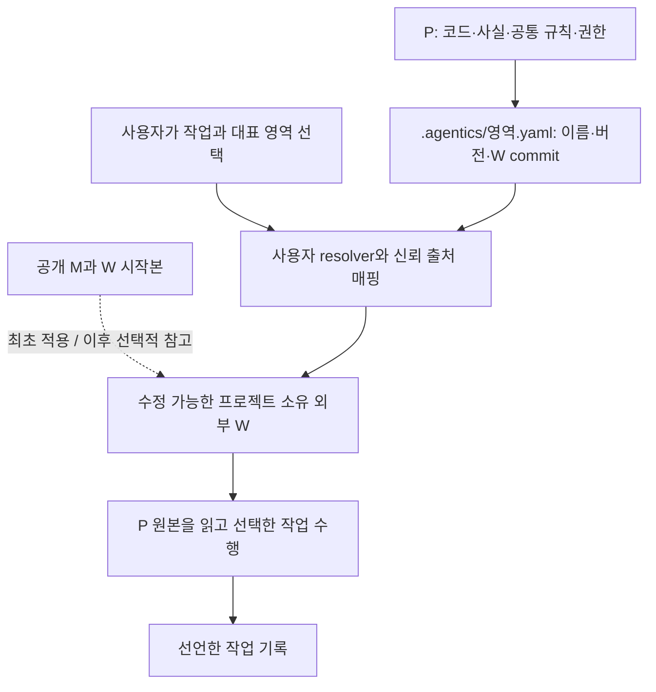

# 프로젝트 소유 W 적용 — 1.0

M은 출발점으로 제시한 공개 방법론이다. 이를 적용한 뒤 W·P를 프로젝트에 맞게 계속 발전시키는 것을 권장한다. M의 지속 사용·revision 추적·업데이트 수용은 사용자 선택이며 의무가 아니다. [English](../../docs/customization.md).

1.0은 **읽기 전용 resolver와 Agent 지원 적용 절차**를 제공한다. 자동 이전기나 세션 관리기는 아니다. 공개된 `v1.0.2` 태그에서 시작하고 프로젝트 W를 파생하기 전에 그 commit을 확인한다.

## 구조와 책임



```text
product/                       공유 P
  src/ tests/ docs/             제품 사실과 결정 원본
  AGENTS.md                    기존 팀 공통 규칙(팀이 사용하는 경우)
  .agentics/default.yaml       선택적 연결만
team-workflow/                 별도 프로젝트 소유 Git 저장소
  profile.json                 P 참조·입구·기록 책임
  workflow/                    수정 가능한 스킬과 절차
  methodology/                 로컬 채택 지원; W 호출부와 함께 수정 가능
  project/*.md                 방법 선택과 P 원본 참조
  LICENSE                      시작본 MIT 고지 보존
user-config/agentics.json      로컬 출처 허용 목록; 기기별 경로
work-records/                  선택한 tracker/저장소; 공개 배포본과 분리
```

기록은 기존 tracker나 명시적으로 선택한 P 경로에 둘 수도 있다. 새 증거 저장소는 의무가 아니다. 시험용 연결은 로컬에만 둘 수 있다. 적용은 AGENTS/CLAUDE 구간·P 스킬·제품 설정을 만들지 않는다. 팀 공통 지침은 방법론 미선택 때도 유효하다.

## 최초 적용

1. 신뢰하는 배포 출처의 전체 Git commit으로 사본을 얻고 검토한다. 내려받은 manifest가 자기 파일과 맞는 것만으로 출처를 증명하지 않는다. 로더도 실행 코드이므로 배포 출처를 확인한다. Python 3.8+와 Git 2.36+가 필요하다. POSIX는 `python3`, Windows는 `python`/`py -3`를 쓴다. local-docs tracker를 쓰면 Git 2.38+를 권장한다. 병합 가능 여부 확인에 `git merge-tree --write-tree`를 쓰며, 이전 Git은 일회용 worktree에서 시험 병합하는 방식으로 대신한다.
2. P 밖에 프로젝트 소유 Git 저장소를 만든다. `ko/adaptive-sdd/workflow/`·`methodology/`·`LICENSE`를 시작점으로 복사한다(영문은 `adaptive-sdd/`). `install.py init/render`를 실행하거나 생성 입구를 P에 복사하지 않는다.
3. W를 수정하고 소비 단계 전에 외부 `project/*.md` 적용 문서를 준비한다. 시작본의 아홉 역할은 `agent-instruction-policy`, `build`, `execution-routing`, `issue-priority`, `issue-writing-guide`, `module-boundaries`, `sdd-workflow`, `skill-evals`, `tracker`다. `templates/project/*.md.tmpl`은 필드 체크리스트로 참고하며 승인된 설정으로 쓰지 않는다. 이 경로의 적용 문서는 직접 수정 가능하다.
4. 제품 사실·필수 테스트·승인 권한·위임·모델 금지는 P의 승인 원본과 연결한다. 등급·리뷰 깊이·방법론 routing·추가 방법론 판단 지점은 W에 둔다. P 문서가 없으면 코드/CI 관찰·추론·규칙 제안을 구분한다. 확정된 제품 결정은 일반 제품 변경으로 P에 기록하며 방법론 적용이 승인 권한을 만들지 않는다.
5. 아래 외부 profile을 작성한다. 적용 시작 전에 작업 기록 위치·접근·보존 책임·revision 대응을 확인한다. 추가 SDD 위치는 해당 단계에서 정하고 이미 선언했으면 재질문하지 않는다. 없으면 의존 단계만 멈추고 묻는다. P에 조용히 쓰거나 새 외부 저장소를 강요하지 않는다. 제품 증거를 공개 배포 저장소에 넣지 않는다.
6. 프로젝트 W를 검토하고 자체 저장소에 commit한다. origin과 사용자 허용 목록을 설정한다. P에 `.agentics/<영역>.yaml`을 추가하며 **공개 M이 아닌 W commit**을 쓴다. 적용이 P에 만드는 파일은 이 연결뿐이며 모든 작업에 W를 선택하는 효과가 없다.

최초 구성 요청 예:

```text
검토한 공개 방법론을 출발점으로 외부 프로젝트 소유 W를 구성해줘.
P의 사실·공통 규칙·권한은 P에 유지하고 W를 프로젝트에 맞게 수정해줘.
공개 M의 지속 사용이나 동기화를 전제하지 말고 1.0 적용 가이드를 따라줘.
방법 선택과 미결 권한·기록 위치를 사용 전에 보여줘.
P에는 선택한 .agentics/<영역>.yaml만 만들고 아직 W를 활성화하지 마.
```

## 연결과 사용자 허용 목록

`.agentics/default.yaml`은 세 개의 따옴표 없는 한 줄 scalar만 허용하는 YAML 부분집합이다. 이름은 영문·숫자로 시작하고 영문·숫자·점·밑줄·하이픈을 쓴다. 빈 줄·독립 주석 줄은 허용하며 중첩 YAML·alias·중복 키·URL은 거부한다.

```yaml
methodology: example-team
version: team-1
commit: <소문자 40자리 전체 W commit SHA>
```

placeholder는 실제 SHA로 바꾼다. `methodology`는 프로젝트 방법 이름, `version`은 표시 이름이며 공개 M 버전이 아니다. 여러 영역을 수정해도 대표 영역 하나를 고른다. 다른 방법을 암시적으로 선택하지 않고 영향 영역의 P 규칙을 모두 적용한다.

사용자 소유 허용 목록은 **P 밖**에 둔다. 실제 신뢰 경로와 origin으로 바꾸며 Windows 경로는 `C:/...`로 쓸 수 있다.

```json
{
  "schema": 1,
  "sources": {
    "example-team": {
      "root": "/absolute/path/to/team-workflow",
      "origin": "https://example.invalid/team/workflow.git"
    }
  }
}
```

허용 목록은 로컬 Git `insteadOf` URL 치환 이후의 유효 origin을 쓴다. resolver는 origin 문자열·HEAD·profile 식별·checkout 청결을 비교한다. 원격 진위나 서명이 아닌 로컬 일관성 검사다. 최초 로더 배포·저장소 획득·허용 목록의 신뢰는 사용자가 정한다. 원격 fetch나 연결 데이터의 명령 실행은 없다. P와 W는 전체 로컬 clone이어야 한다. lazy-fetch 환경 변수를 지원하지 않는 이전 Git에서도 status 전에 partial/promisor clone을 거부한다. 클라우드는 같은 승인 origin/commit을 자체 root에 준비하고 같은 이름에 매핑한다. W의 symlink·submodule·assume-unchanged/skip-worktree/sparse 항목·미추적·ignored 파일은 지원하지 않는다. 전용 clean W checkout을 쓰고 기록은 밖에 둔다. P는 dirty일 수 있으며 무관한 변경을 보존한다. 입구는 추적된 파일이어야 하고 W/지원 디렉터리에는 추적 파일이 있어야 한다. Git 호출은 wrapper의 저장소·index·명령줄 설정 재지정 환경 변수를 무시하고 사용자 config 위치는 유지한다. W의 편집기 폴더나 `.DS_Store`도 차단되므로 전용 checkout을 깨끗하게 유지한다. 1.0은 기존 commit이 있는 SHA-1 저장소를 지원하며 unborn·SHA-256 저장소는 지원하지 않는다.

## 외부 프로필

```json
{
  "schema": 1,
  "methodology": "example-team",
  "version": "team-1",
  "entry": "workflow/activation.md",
  "paths": {"workflow": "workflow", "supports": "methodology"},
  "product_sources": [
    {"path": "docs/project-rules.md", "revision": "task-start", "kind": "approved-rule"},
    {"path": "docs/architecture.md", "revision": "task-start", "kind": "fact"},
    {"path": "docs/authority.md", "revision": "task-start", "kind": "authority"}
  ],
  "records": {
    "location": "소유자가 선택한 기존 프로젝트 tracker",
    "retention_owner": "프로젝트 팀",
    "revision_relation": "각 작업에 제품 기준/최종 revision과 선택한 W commit 연결",
    "access_failure": "stop-dependent-work"
  }
}
```

실제 P 원본 경로를 쓰며 예시 이름의 문서를 새로 만들 필요는 없다. 경로는 각 root 기준 상대 경로이며 traversal·symlink는 거부한다. kind는 `fact`, `approved-rule`, `authority`다. 1.0은 `task-start`만 구현하며 P HEAD와 dirty 여부를 출력한다. 실제 읽은 원본 revision/content identity는 Agent가 기록한다. HEAD만으로 dirty 내용을 식별하지 못한다. 파일 존재·기록 선언만으로 실제 읽기·tracker 접근·쓰기 권한·수행을 증명하지 않는다. 의존 편집 전에 확인한다. profile이 입구를 선택하므로 공개 M을 계속 따르는 대신 프로젝트 입구로 교체할 수 있다. `paths.workflow`는 필수 상대 디렉터리이고 `paths.supports`는 상대 디렉터리 또는 null이다. resolver는 절대 `workflow_dir`와 `methodology_dir`(null 가능)를 출력한다. 제공된 시작본에는 복사한 지원이 필요하며 M 호출부를 제거한 커스텀 W는 null로 선택할 수 있다. 공개 M은 요구하지 않는다.

## 명시적 작업 활성화

새 세션에서 방법·제품·작업·대표 영역을 선택하고 검토한 배포본을 실행한다.

```text
python3 -I -B <trusted-distribution>/ko/adaptive-sdd/tools/agentics.py --selected --fresh-session --project-root <P> --area default --task T-12 --config <user-config>/agentics.json
```

`--task`는 tracker ID일 필요가 없는 호출자 지정 label이다. Issue 생성 전에는 `new-item` 같은 임시 label을 쓰고 실제 ID와의 대응을 기록한다. `#31` 같은 ID는 `issue-31` 같은 안전한 label로 연결한다. 연결은 이 resolver만 파싱하며 일반 YAML parser가 다른 타입으로 추론해도 이름·버전은 문자열이다.

`--selected`가 없으면 연결/config/W를 읽지 않고 INACTIVE다. 선택 후 실패는 BLOCKED(exit 2)이며 다른 방법으로 대체하지 않는다. READY(exit 0)는 연결 확인 성공이며 실행이나 준수의 증거는 아니다. 입구·해당 P 원본·W 절차를 읽고 기록 접근·권한을 확인한 뒤 편집한다. `--fresh-session`은 호출자 선언이며 호스트 문맥 검사나 초기화 기능이 아니다.

시작본의 [작업 선택 계약](../adaptive-sdd/workflow/activation.md)이 W 상대 문서·로컬 채택 M 지원·기존 hard guard/pin 참조의 호환 의미를 정한다. 설치 AGENTS 구간이나 기존 lock을 요구하지 않는다. W와 호출부를 함께 수정한다. 현재 gate를 우회하려고 작업에서 선택한 W를 수정하지 않는다. 의도적인 W 변경은 commit하고 이후 작업에서 선택한다.

네이티브 스킬 설치는 필요 없다. 사용자가 확인된 입구 읽기를 직접 요청할 수 있다. 개인 로더 스킬은 선택·연결 확인만 담는다. Claude Code는 `disable-model-invocation: true`, Codex는 `agents/openai.yaml`의 `policy.allow_implicit_invocation: false`로 암시 호출을 막는다. 이미 읽은 지침 삭제 기능은 아니다. [Claude 공식 문서](https://code.claude.com/docs/en/skills), [Codex 공식 문서](https://learn.chatgpt.com/docs/build-skills), 2026-11-06 확인. 1.0은 네이티브 로더를 설치하거나 실증했다고 주장하지 않는다.

종료 증거 보존 후 해당 작업의 방법론 범위를 끝낸다. 다음 작업·대표 영역·방법론은 새 세션에서 시작한다. 종료 메시지나 스킬 비활성화로 기존 지침을 지울 수 없다. P 권한은 계속 유효하다. 선택 후 로드/접근 실패는 의존 작업을 막지만 미선택 방법론은 일반 작업을 막지 않는다.

## 업데이트와 이전

M 업데이트는 선택이다. 유지·수정·부분 채택·참고 중단은 사용자가 판단한다. 커스터마이징 W를 공개 번들로 덮어쓰지 않는다. 요청받았을 때 지정한 공개 변경을 비교하고 프로젝트 권한으로 반영을 정한다. 출처 기록은 선택이며 작업 절차는 선택한 **W commit**으로 식별한다.

W는 자체 리뷰 절차를 따른다. 진행 작업은 기존 snapshot을 유지하거나 새 세션으로 명시적으로 인계한다. 폐기 feed·취약 버전 공지·자동 업데이트·호스트 세션 관리는 미구현이다. 사용 중단이 필요하면 사용자가 매핑을 제거하거나 W commit을 거부할 수 있다.

[기존 가이드](legacy-installation.md)와 `install.py`는 기존 설치와 그 방식을 명시적으로 고른 사용자를 위해 유지한다. 생성물·고정 사본 검사는 그 모델에만 적용한다. 이전은 검토한 제품 변경이다.

1. 설치 사본·생성 구간/입구·사용자 수정·권한·증거 참조를 목록화한다. 진행 작업과 사본을 보존한다.
2. 외부 W를 준비한다. 방법 선호를 옮기되 P 사실·권한을 유지한다. `human_judgment`/`hard_guard_extra` 전체를 선호로 자동 분류하지 않는다.
3. 일반 제품 PR에서 설치기 소유가 확인된 방법론 구간/입구만 제거한다. 사용자 텍스트와 팀 공통 규칙을 보존한다. 기존 renderer는 재생성하므로 이후 실행하지 않는다. 진행 작업/참조가 없어야 오래된 사본을 정리한다.
4. 영역 연결을 추가하고 새 세션에서 선택/미선택 동작을 확인한다. 위치만 밖으로 옮기면 자동 활성화가 남으므로 이전 완료가 아니다.

매번 편집 전 M 절차를 강제하는 기존 P overlay도 분류·재배치 대상이다. 이 릴리스는 기존 제품 저장소를 이전하지 않는다.

외부 적용에서 선택적인 snapshot 도구를 사용하면 검토한 배포본의 `ko/adaptive-sdd/tools/review_snapshot.py`를 사용하거나 그 파일을 W 저장소의 `tools/`로 복사한다. 기존 외부 설치의 `.agentics/adaptive-sdd.json`도 이전 목록에 포함하고 활성 참조가 없음을 확인한 뒤 기존 설치 생성물로 정리한다.

## Task별 임시 출력과 호스트 통제

작업에 쓰기 허용한 root와 별도의 task별 scratch/cache/output 경로를 선언한다. 제품, 외부 W, 기록, scratch의 권한은 서로 다르며 W는 선택한 작업 중 읽기 전용이다. 임시 경로와 언어별 캐시/컴파일 출력을 그 경로로 설정하고 기존 host sandbox에서 다른 쓰기를 제한한다. OS 임시 경로가 기본 허용되는 host는 해당 허용도 확인한다. 먼저 무해한 외부 쓰기 거부와 내부 쓰기 성공을 실제 확인하고, 실패하면 격리된 실행 환경을 준비하거나 강제를 미확인으로 명시한다. 이 배포본은 OS sandbox를 설치하지 않으며 resolver READY가 파일 접근을 강제하지 않는다. 일반 Trivial/Small은 선택한 W의 `workflow/process/small-work.md`를 사용한다.

sandbox가 다른 OS 계정으로 실행되면 구현 전에 그 계정에서 Git 접근과 선언한 compiler/runtime을 확인한다. Git이 소유권 신뢰 오류를 내면 실제 프로젝트/시험 저장소를 확인하고 세션별 Git 설정에 그 정확한 경로만 등록한다. wildcard나 사용자 전체 신뢰 설정의 암묵적 변경은 하지 않는다. 접근할 수 없는 도구는 sandbox를 끄는 대신 허가된 읽기 위치에 준비한다.
